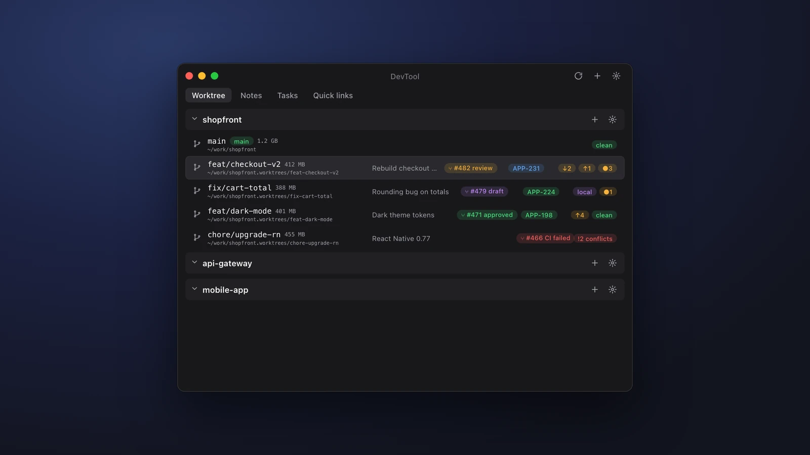
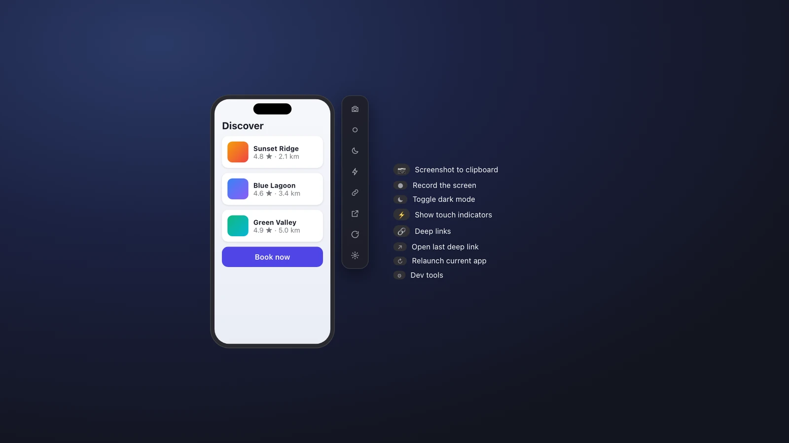
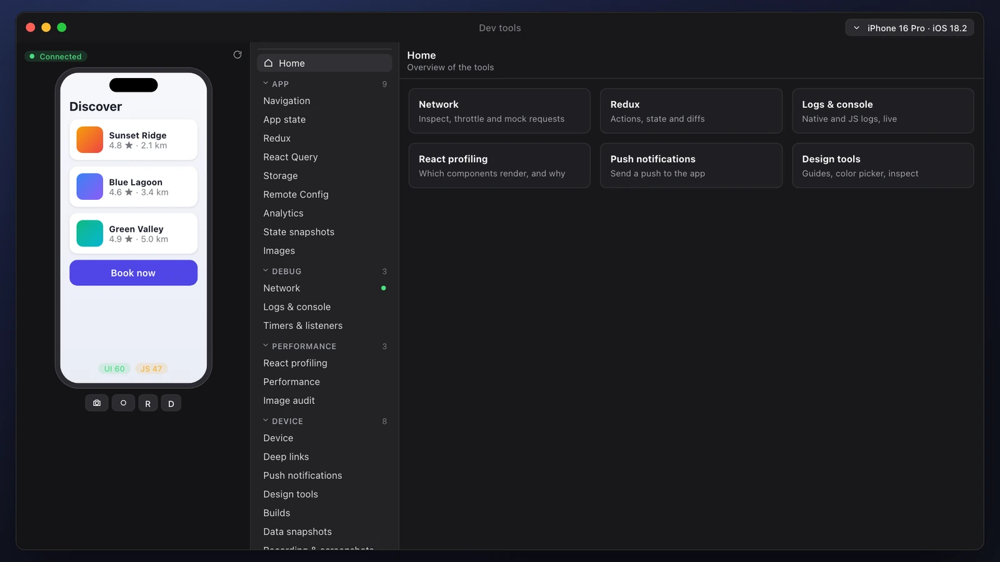
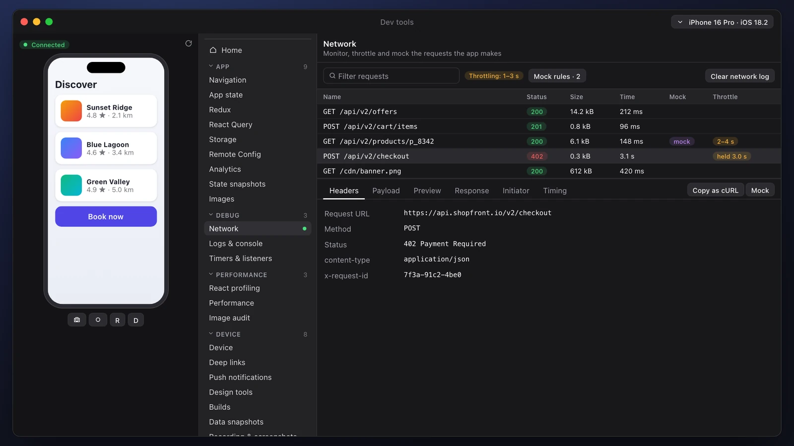
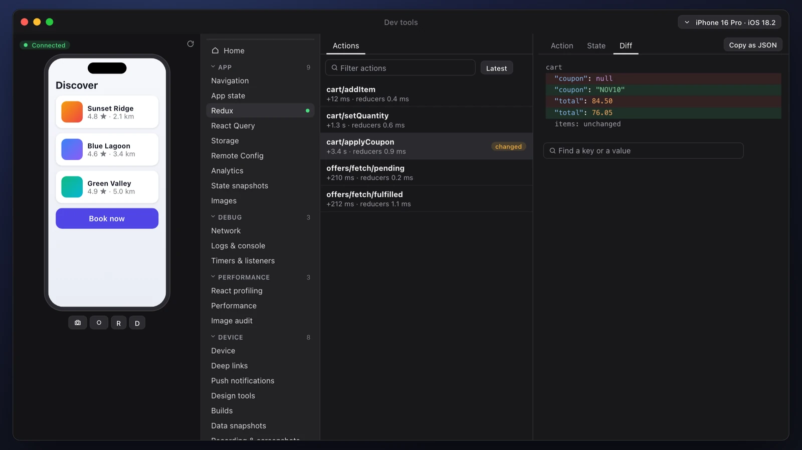
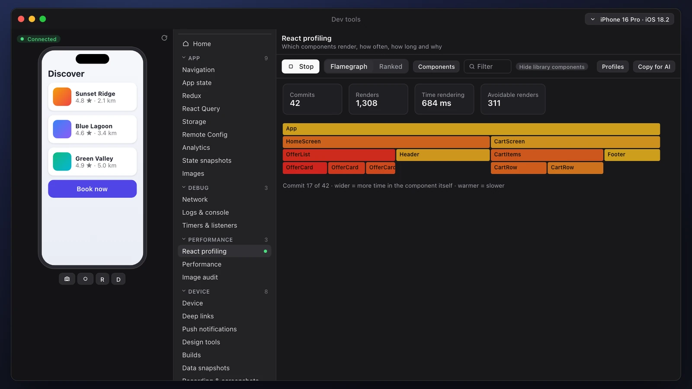
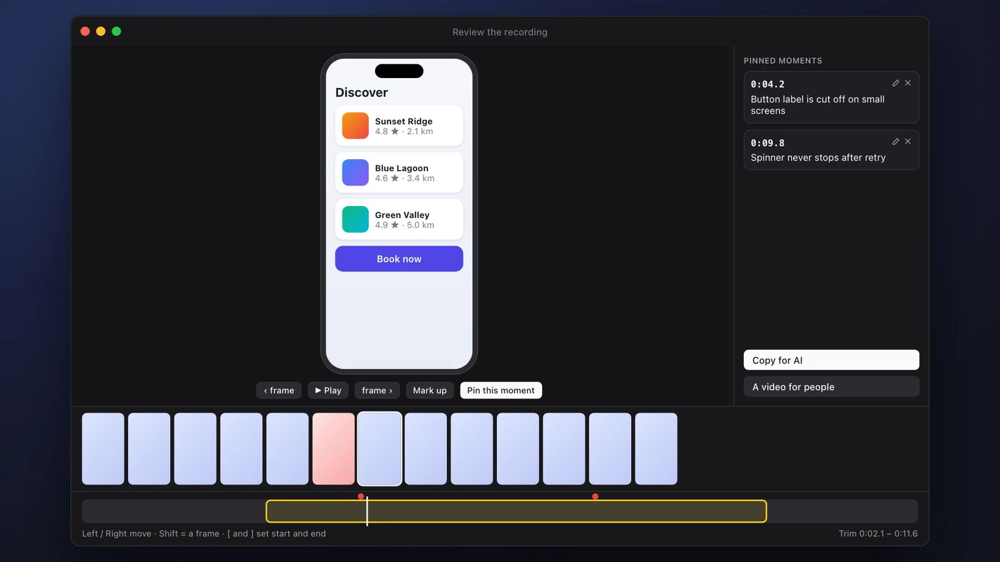
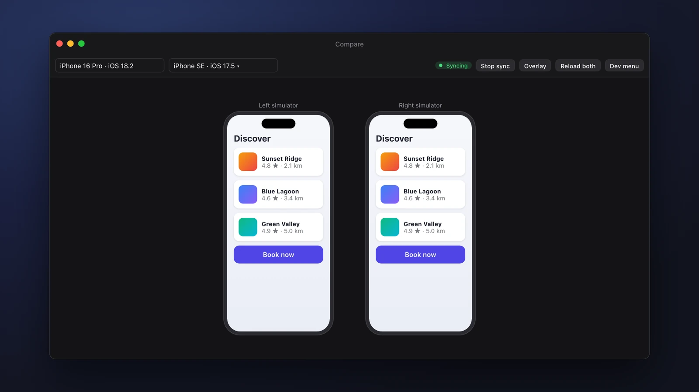

# DevTool

A native desktop app for managing git worktrees on macOS, with built-in device tools for iOS and Android development (simulators/emulators, logs, network, storage, and more).

This repository is the **download and support home** for DevTool. It does not contain the application's source code.

## Features

<p align="center">
  
</p>

DevTool manages Git worktrees, and bundles a toolbox for React Native development on iOS simulators, Android emulators and real phones. Each area below has its own page with details and screenshots.

<table>
<tr>
<td width="50%" align="center"><a href="docs/features/worktrees.md#worktree-list"></a><br><sub><b>Worktrees at a glance</b></sub></td>
<td width="50%" align="center"><a href="docs/features/quick-bar.md#the-bar"></a><br><sub><b>Quick bar beside the device</b></sub></td>
</tr>
<tr>
<td width="50%" align="center"><a href="docs/features/devtools.md#live-device-screen"></a><br><sub><b>Live device and Dev tools</b></sub></td>
<td width="50%" align="center"><a href="docs/features/devtools-debug.md#network"></a><br><sub><b>Network: inspect, throttle, mock</b></sub></td>
</tr>
<tr>
<td width="50%" align="center"><a href="docs/features/devtools-app.md#redux"></a><br><sub><b>Redux actions and diffs</b></sub></td>
<td width="50%" align="center"><a href="docs/features/devtools-debug.md#react-profiling"></a><br><sub><b>React render profiling</b></sub></td>
</tr>
<tr>
<td width="50%" align="center"><a href="docs/features/quick-bar.md#review-a-recording"></a><br><sub><b>Review a screen recording</b></sub></td>
<td width="50%" align="center"><a href="docs/features/devices.md#compare-window"></a><br><sub><b>Compare two simulators</b></sub></td>
</tr>
</table>

Click any picture to read more, or pick an area:

| Area | What's inside |
|---|---|
| [Worktrees](docs/features/worktrees.md) | Worktree list · One-click IDE launch · Search and keyboard navigation · Quick actions on each row · Create a worktree · Create from the clipboard · Deep links · Edit and delete |
| [Projects](docs/features/projects.md) | Add a project · Switch and reorder · Project settings |
| [GitHub and Jira](docs/features/integrations.md) | GitHub · Jira · Your credentials stay on your Mac |
| [Settings](docs/features/settings.md) | General · Appearance · IDE · Worktree |
| [Notes, tasks and quick links](docs/features/notes-tasks-links.md) | Notes · Tasks · Quick links |
| [Working with macOS](docs/features/system-integration.md) | Spotlight · Global shortcut and menu bar · Launch at login · In-app updates |
| [Simulators, emulators and real devices](docs/features/devices.md) | Device list · Real phones · Device notes · Native logs window · Compare window |
| [Quick bar](docs/features/quick-bar.md) | The bar · Screenshot · Screen recording · Review a recording · Deep links on the bar · Android navigation mode |
| [Dev tools window](docs/features/devtools.md) | Live device screen · Finding and running tools · Device switcher · Mac usage |
| [Dev tools: your app](docs/features/devtools-app.md) | Navigation · App state · Redux · React Query · Storage · Remote Config · Analytics · State snapshots · Images |
| [Dev tools: debug and performance](docs/features/devtools-debug.md) | Network · Logs and console · Timers and listeners · React profiling · Performance · Image audit |
| [Dev tools: device](docs/features/devtools-device.md) | Device settings · Location · App data · Cookies and local storage · Deep links · Push notifications · Design tools · Design overlay · Builds · Data snapshots · Recording and screenshots · Permissions |
| [Dev tools: computer and utilities](docs/features/devtools-computer.md) | Mac storage · Mac permissions · JSON viewer · JSON compare · Base64 · JWT |
| [Small utilities](docs/features/utilities.md) | Opacity to hex · Color converter · Lorem ipsum |
| [Requirements and limits](docs/features/requirements.md) | What you need · Good to know |

## Download

Grab the latest `.dmg` from [Releases](../../releases/latest).

Open the `.dmg` and drag DevTool to Applications.

### First launch (unsigned-for-distribution builds)

This build isn't notarized by Apple yet, so macOS will refuse to open it and say it "could not verify DevTool is free of malware" — and **the usual fixes (double-click, right-click → Open, or Settings → Privacy & Security → Open Anyway) will not work for this particular warning.** That only works for a different, less strict category of unsigned app.

To open it anyway, once DevTool is in your Applications folder, run this once in Terminal:

```bash
xattr -cr /Applications/DevTool.app
```

(The app is always named `DevTool.app` there, with no version number, even though the `.dmg` you downloaded has one.)

**Haven't dragged it to Applications yet?** Clear it on the `.dmg` itself first, before opening it:

```bash
xattr -d com.apple.quarantine <path to the downloaded .dmg>
```

If you'd rather not type a path, type `xattr -d com.apple.quarantine ` (or `xattr -cr `) with a trailing space, then drag the `.dmg` or the app's icon from Finder into the Terminal window — it fills in the exact path for you — and press Return.

We know this is a rough first step and are working on a properly notarized build, which won't need this.

### Requirements

- macOS 10.15 or later
- Xcode (for iOS simulators) and/or Android Studio (for emulators), if you plan to use the device tools

## Reporting issues

Found a bug or have a feature request? Please [open an issue](../../issues/new/choose) — use the bug report or feature request template so we have what we need to help.

Before filing, please check [existing issues](../../issues) first.

## What's collected

DevTool sends anonymous, aggregate usage statistics (which features are used, app and OS version) and crash reports, to help us fix problems and prioritize what to build next. No file paths, repository names, branch names, credentials, or file contents are ever collected. See [NOTICE.md](NOTICE.md) for details.

## License

DevTool is proprietary, closed-source software. See [LICENSE.md](LICENSE.md) for the terms under which it is distributed. The source code is not published, and reverse engineering is prohibited except where applicable law gives you that right despite this restriction.

## Support

For a security issue, please use GitHub's private [report a vulnerability](../../security/advisories/new) form rather than a public issue.
