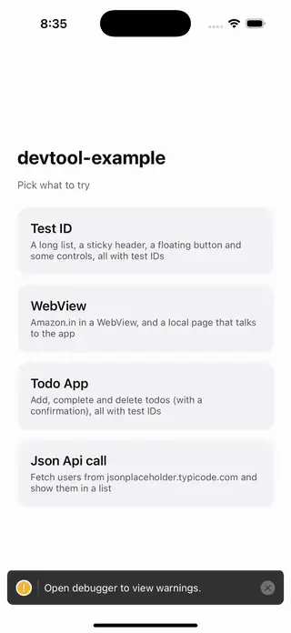
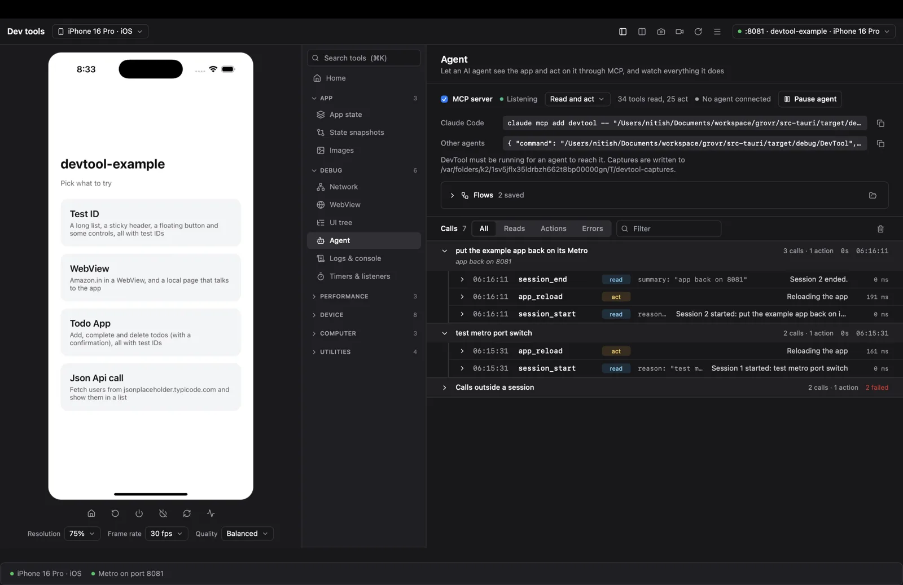

# AI agents (MCP)

Let an AI agent see what your app is doing and drive it, then hand you what happened.

[← All features](../../README.md#features)

**On this page:** [How it works](#how-it-works) · [Connect an agent](#connect-an-agent) · [Sessions](#sessions) · [What an agent can do](#what-an-agent-can-do) · [Captures](#captures) · [Taps that cannot go wrong](#taps-that-cannot-go-wrong) · [Replay without the agent](#replay-without-the-agent) · [Control and safety](#control-and-safety) · [Limits](#limits)

An agent doing a task in the example app, recorded with <code>recording_start</code>. <a href="images/agent-demo.mp4">Watch it as a video</a>.

## How it works

DevTool speaks [MCP](https://modelcontextprotocol.io), the protocol coding agents such as Claude Code and Cursor use to call tools.

- The agent starts **the DevTool app itself** as a small command (`DevTool --mcp`). It opens no window.
- That command passes each call to the **running DevTool** over a socket in your home folder that only you can open. Nothing goes over the network.
- DevTool owns every connection to your device, so there is one place that reads and drives it, and your own tools keep working beside the agent.
- The agent gets **short answers and file paths, not walls of data**: a request log is written to a folder, and the agent opens only the files it needs.

## Connect an agent

1. Open **Dev tools → Debug → Agent** and turn on **MCP server**. It is off until you do, and while it is off nothing is listening.
2. Copy the command shown (for Claude Code: `claude mcp add devtool -- "<path to DevTool>" --mcp`), or the JSON settings for another agent, and add it to the agent.
3. Keep DevTool running. The window header shows **Agent connected** while one is.

## Sessions

An agent starts every task by opening a **session** with a reason, and no other tool works until it has:

- `session_start` takes a short reason, such as "Reproduce the checkout crash on the payment screen". The agent is told to call it first.
- Everything it does afterwards is filed under that session. The Agent tool shows each session as a card with its reason, the agent's name, how many calls and actions it made, how many failed, how long it took, and whether it is still **active**. Click a card to collapse or open its calls. The newest session, and any still going, are open.
- `session_end` closes it with a line on how it went, which appears under the reason. The agent is told to call it as its last step, before it answers you, so you never have to ask. A session also ends when the agent starts another or disconnects.
- **If the agent forgets**, a session that has had no call for a minute shows as **idle**, and after **5 minutes** without a call DevTool ends it (marked *ended automatically*). A later call from the agent reopens it.
- Calls made before a session was open are refused, and listed under **Calls outside a session**.

## What an agent can do

| Group | Tools |
|---|---|
| **Sessions** | `session_start` (with a reason; call it first) · `session_end` |
| **See** | `devices_list` · `ui_tree` (what is on screen by test ID, label and text, and how much of each is in view) · `screenshot` · `recording_start` / `recording_stop` (the video and a sheet of eight frames from it) · `app_state` (navigation, Redux, Zustand/Jotai/MobX stores, with what changed since the last read) |
| **Look inside the app** (React Native, dev build) | `navigation_routes` · `analytics_events` (what the analytics SDKs sent) · `redux_actions` (the dispatched actions, and what one changed) · `query_state` (React Query: problems first) · `storage_read` (AsyncStorage and MMKV) · `remote_config_read` · `inspect_element` (the components, props, style and source behind a view) · `logs_read` · `timers_report` (timers and listeners that look like leaks) · `perf_status` (memory, startup, JS thread frame rate) · `image_audit` (oversized and blurry images) · `state_snapshot_take` / `state_snapshot_compare` |
| **Profile renders** | `profile_start` · `profile_stop`: which components rendered, how long they took, and which rendered with nothing new to show, with the props that keep changing |
| **Record** | `capture_start` · `capture_mark` · `capture_wait_for` · `capture_summary` · `capture_status` · `capture_stop` |
| **Tests that see the same API** | `cassette_record_start` / `cassette_record_stop` (record the app's API and the steps) · `cassette_replay` / `cassette_replay_stop` · `flow_run`. See [flows and cassettes](flows.md) |
| **Act on the screen** | `ui_tap` · `ui_type` · `ui_swipe` · `ui_locate` (scroll something into view) · `ui_scroll` (a list to its top or its very end, or by a page) · `ui_press_button` · `ui_wait_for` |
| **Change the network** | `network_mock` · `network_throttle` · `network_rules_list` · `network_rules_clear` |
| **Change the app's state** | `navigate_to` · `navigate_back` · `storage_write` · `storage_remove` · `remote_config_override` · `perf_gc` |
| **Change the device or app** | `app_open_link` · `app_reload` · `device_location` · `device_setting` · `push_send` · `snapshot_list` · `snapshot_restore` · `device_reboot` |

Every tool says whether it only looks, so the agent's own permission prompts (and DevTool's **Read only** mode) can tell them apart. `device_reboot` and `snapshot_restore` are marked destructive.

## Captures

A capture is how an agent finds out what happened without asking for data one piece at a time.

1. `capture_start` records the app's **network** and **console** (or just one).
2. The agent acts on the app. Each of its actions is added to a timeline by itself, and `capture_wait_for` waits for a request to finish or a console message so there is no polling.
3. `capture_stop` writes a folder in the temp folder (beside your screenshots and recordings) and replies with a short summary: how many requests, which failed, the slowest, the console errors.

What is in the folder:

- **`README.md`**: the summary, and what to read first
- **`timeline.md`**: everything in order: the agent's actions, requests, console errors and warnings, and markers, with request numbers
- **`network/index.tsv`**: every request on a line, with the failed, slowest, largest and repeated ones listed first
- **`network/endpoints.tsv`**: calls, errors and timing per endpoint, with ids in paths shown as `:id`
- **`network/requests/N.json`**, **`network/bodies/N.*`** and **`network/shapes/N.json`**: the details of one request, its response, and the structure of a JSON response without its values
- **`console/summary.tsv`** and **`console/full.log`**: errors and warnings grouped with counts, and every message
- **`agent-log.jsonl`**: every call the agent made, with what it was told
- **`recipe.maestro.yaml`**: the agent's steps as a flow you can run again

A capture ends by itself after 10 minutes (up to 30). Nothing is kept for a device with no capture running.

## Taps that cannot go wrong

An agent asks for an element by its **test ID** (or its text or label). Before DevTool touches anything it:

1. **finds** the element, looking through a long list a page at a time when the item is not on screen yet;
2. **scrolls it into view**, to the middle of its scroll view, and waits for the scroll to stop;
3. **checks with the app's own hit test** that a touch at that point would reach it, and not a header, a floating button or a modal on top. If something covers it, it scrolls it clear and checks again.

If the element cannot be made visible and reachable, **nothing is tapped** and the agent is told why. See [adding test IDs](test-ids.md).

## Replay without the agent

To run a use case again with the same data every time, record it as a cassette and a flow: see [flows and cassettes](flows.md). Run it with `DevTool --run`.

When a capture holds the agent's steps on the screen, `recipe.maestro.yaml` writes the ones that worked as a [Maestro](https://maestro.mobile.dev) flow: taps, typing, swipes, waits and links. Mocks, throttles and restored data cannot be repeated by Maestro, so they are comments to set up first. Run it with `maestro test recipe.maestro.yaml`.

## Control and safety

- **Read and act** (the default) or **Read only**: read only refuses every tool that changes something on the device, whatever the agent's own permissions say.
- **Pause agent** refuses every call until you resume, without turning MCP off.
- **The Agent tool** lists every call as it happens, nested under its session, with what was asked and what the agent was told. Filter by reads, actions and errors. A screenshot shows as a small picture on its row, and opening the call shows it full size (the shrunk copy the agent receives, when it asked for the picture). A recording shows the sheet of frames the agent can look at, and a card to open or reveal the video.

- **Mocks and throttles an agent sets** are named as the agent's, listed in the Agent tool, end by themselves after 10 minutes (up to 60), and never replace the ones you set.
- **Limits that stop a runaway agent:** at most 40 calls in 5 seconds, one acting call at a time, and no call longer than 90 seconds.
- **Nothing is hidden from the agent that you can see:** captures and logs are written as they are, so keep secrets out of the app and its responses. They live in the temp folder and are removed after a day.

## Limits

- Touching the screen works on **simulators and emulators**, through the device screen DevTool shows (it is opened for the agent when it is not). Real phones are not touched.
- Screen tools need a **development build** with Metro running, on React Native's **new architecture**.
- Mocks and throttles apply to requests the app makes from JavaScript (`fetch`, axios), as in the Network tool.
- Typing covers letters, digits and the punctuation of a US keyboard.
- WebView content is not part of the agent's tools yet.
