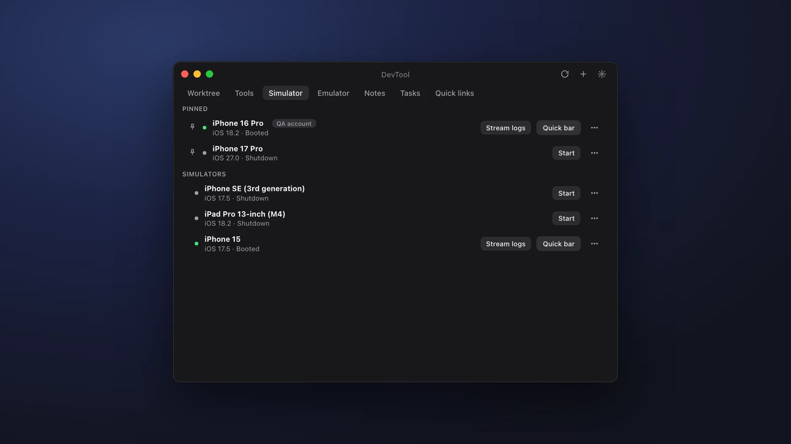
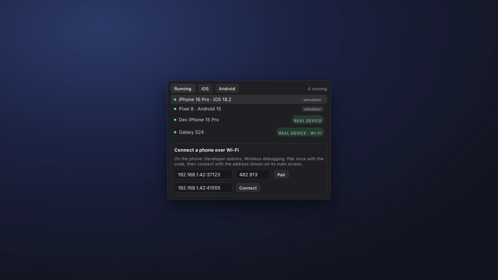
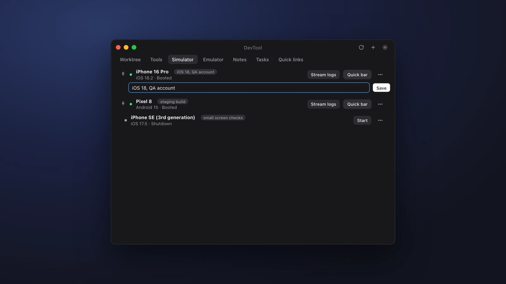
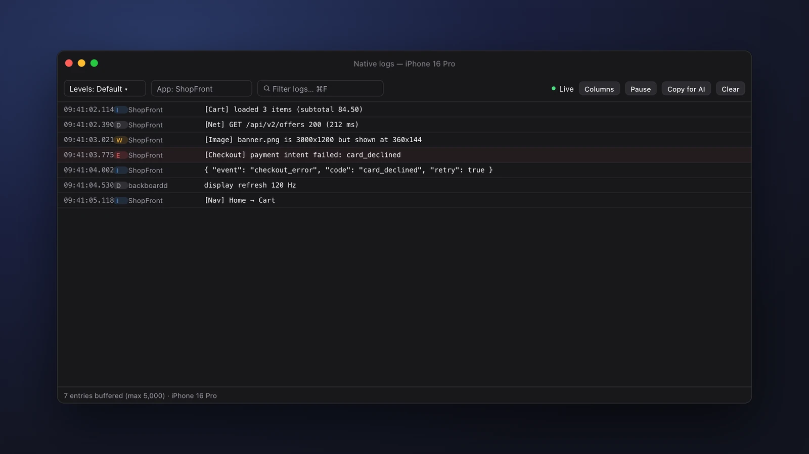
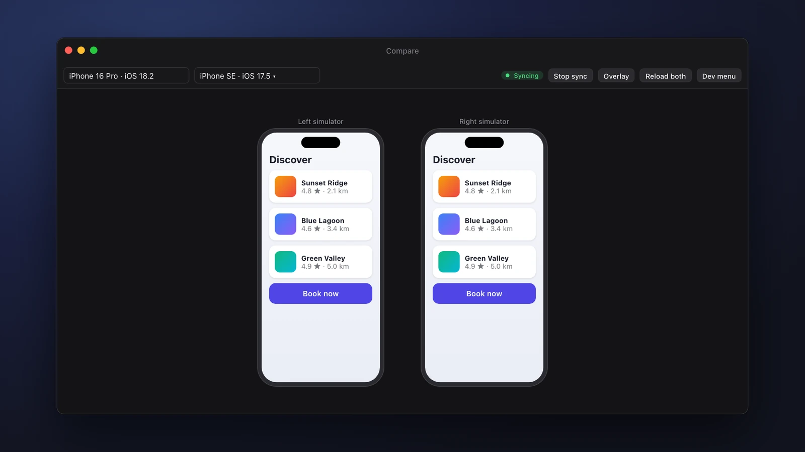
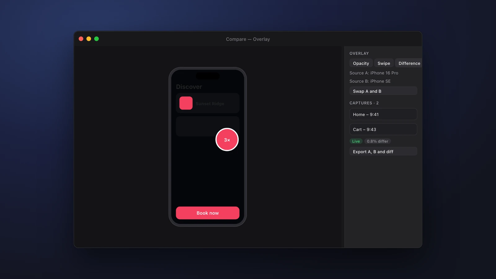

# Simulators, emulators and real devices

Start and manage your test devices from one list.

[← All features](../../README.md#features)

**On this page:** [Device list](#device-list) · [Real phones](#real-phones) · [Device notes](#device-notes) · [Native logs window](#native-logs-window) · [Compare window](#compare-window)

## Device list

Every iOS simulator and Android emulator in one place.

- **Start** a device from the list; one that is already running is not launched twice
- **Pin** favourites to keep them at the top
- **Running state** refreshes on its own
- **Open in Xcode or Android Studio**
- **Stream logs** and toggle the **quick bar** from each row
- **iOS 27 simulators and Xcode 27** are supported

## Real phones

Not just simulators.

- **Real iPhones and Android phones** appear next to your simulators and emulators
- **Android over Wi-Fi:** pair once with the code from the phone, then connect with its address
- **iPhones:** pair them in Xcode once to see them here
- Tools that only make sense on a simulator are switched off for real iPhones

## Device notes

Remember what each device is for.

- A short editable note on every device, such as "iOS 17, QA account"

## Native logs window

The system log of a running device, cleaned up.

- **iOS and Android** logs in their own window
- **Filters:** by level, by text, and by app
- **Columns menu** to show only what you need
- **Pause**, with a 5,000-line buffer
- **Multi-line messages** are joined and **JSON** is pretty-printed
- **Copy for AI:** saves the visible lines to a file and copies a prompt that points to it

## Compare window

Two iOS simulators side by side.

- **Pick the second simulator** from any other running one
- **Sync:** touches and keys go to both screens; start and stop syncing any time
- **Relaunch both** and start in one click
- **Reload or open the developer menu** on both
- **Overlay panel:** lay one screen over the other, or one over an image
- **Modes:** opacity, swipe with a draggable handle, and difference that shows only what differs
- **Magnifier** with zoom, and nudge one side with the arrow keys
- **Live mode** takes new pictures of both screens continuously
- **Captures:** keep named captures, and export both screens and the difference as one picture

