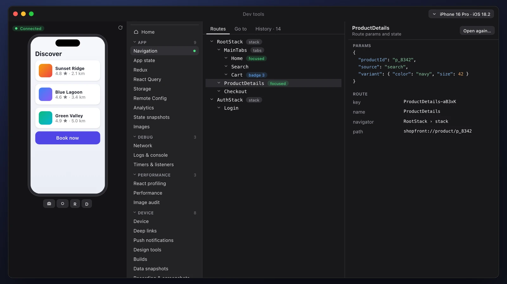
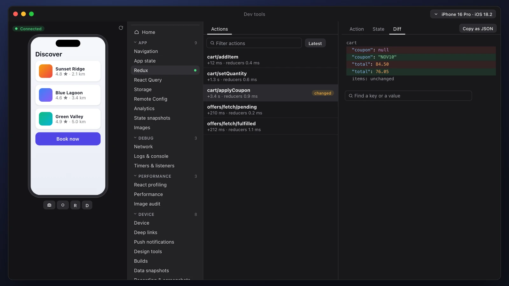
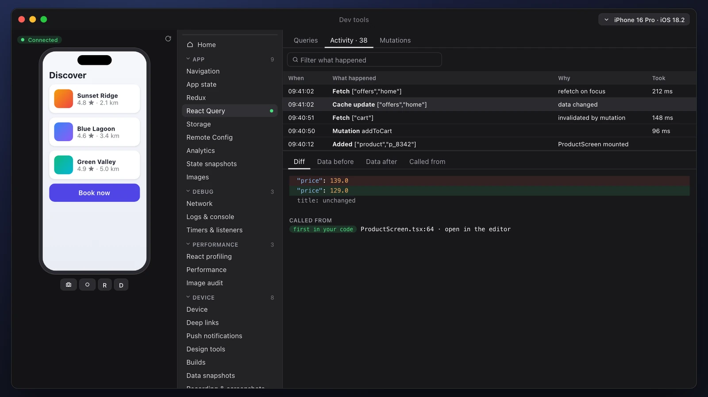
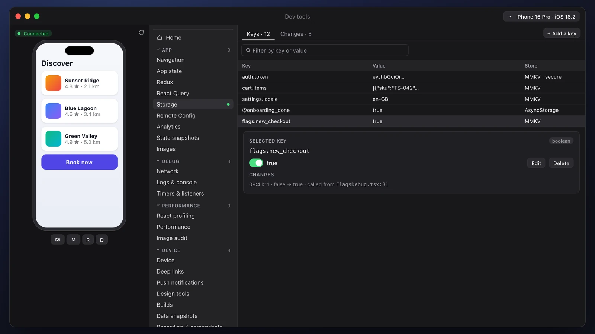
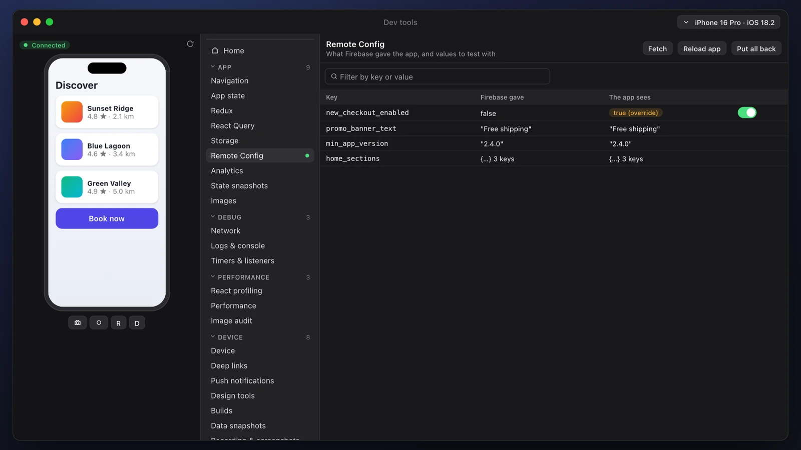
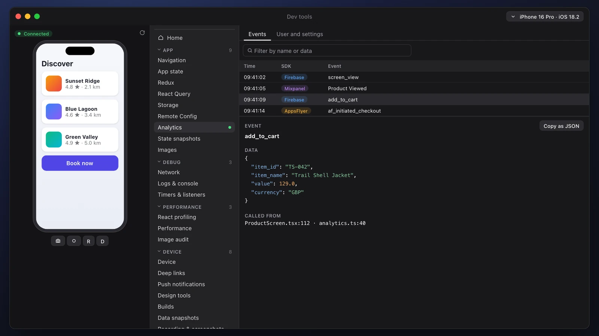
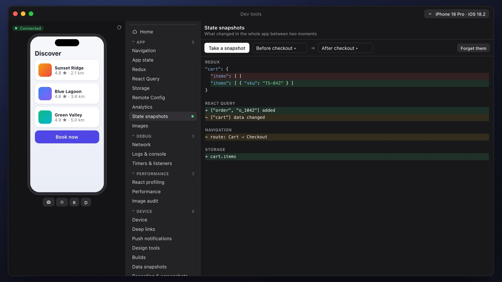
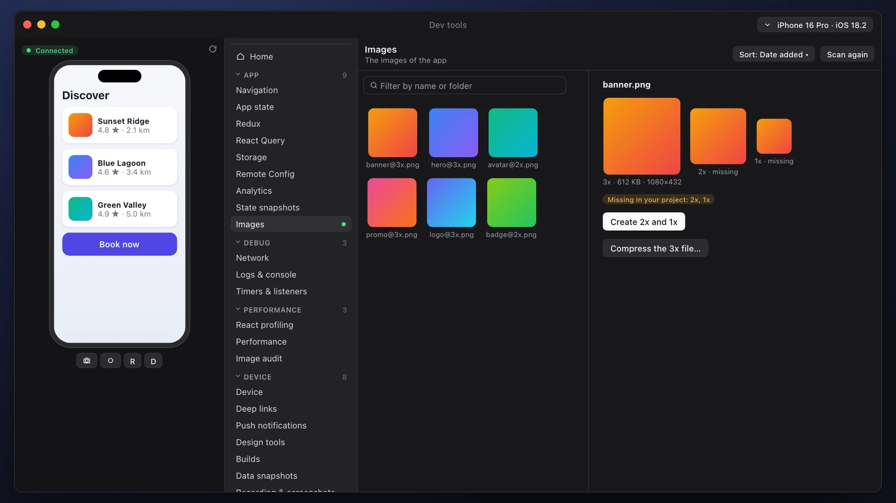
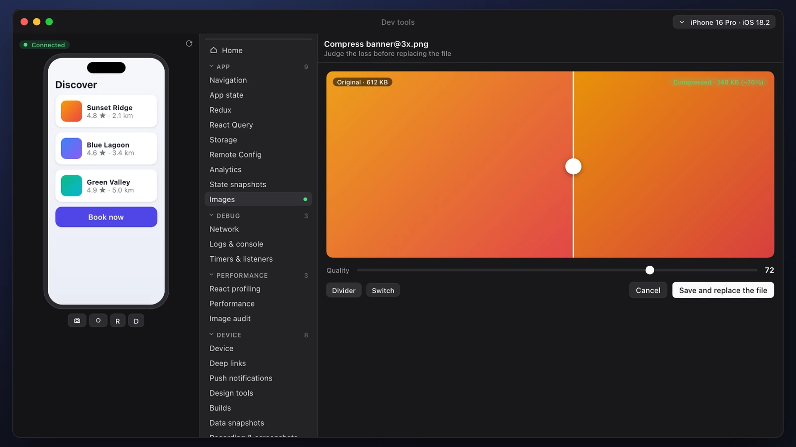

# Dev tools: your app

See inside a running React Native app. Each tool appears only when the project uses the library it reads.

[← All features](../../README.md#features)

**On this page:** [Navigation](#navigation) · [App state](#app-state) · [Redux](#redux) · [React Query](#react-query) · [Storage](#storage) · [Remote Config](#remote-config) · [Analytics](#analytics) · [State snapshots](#state-snapshots) · [Images](#images)

## Navigation

React Navigation 6 and later.

- **Route tree:** every navigator and route as the app has them, with the focused one marked
- **Params** of any route, ready to copy
- **History:** every navigation change, with the action that caused it and the state before and after
- **Go to:** open any screen with params you write as JSON
- **Go back, pop to top, or replace everything** with a single screen
- **Save screens** with their params under a name, and fill the form from them later
- **Open again…** from any route in the tree to retry it with different params

## App state

Everything outside Redux and React Query.

- **Zustand stores, Jotai atoms, MobX observables and React contexts** in one list
- **Value** of each, as a tree
- **Change history** with before, after, and where in the code it was called from
- **Counters:** how often it changed, and how many components read a context
- **Context filters:** hide library contexts, or show only the ones on screen now

## Redux

Redux Toolkit, as in the Redux DevTools.

- **Action list** in order, with time since the one before and how long the reducers took
- **Diff** of what each action changed, with before and after
- **State tree** after or before any action, read a level at a time so huge states stay fast
- **Finder** for a key or value anywhere in the state
- **Filter** actions, clear the list, and follow the latest
- **Copy as JSON** for any value
- **Jump from a diff** to the place in the state
- **Resize** the action list; **reload the app** if its store wasn't picked up

## React Query

TanStack Query's cache, live.

- **Queries:** every query with its state (fetching, stale, inactive, error), filters by key, and sort by most recent activity
- **Query detail:** data, history, the components that use it, and its settings (stale time, retries, refetch rules, network mode)
- **Activity:** fetches with how long they took and why, cache updates with before, after and a diff, queries added and removed
- **Who called it:** the place in your code, opened in your editor
- **Mutations:** variables, result, error, retries and where they were started
- **Copy** a key or a query's data as JSON

## Storage

MMKV and AsyncStorage, live.

- **All keys and values** across every MMKV instance and AsyncStorage
- **Edit, add and delete** keys, with the value type kept (string, number, boolean, JSON)
- **Change log:** each change with before, after and where it came from
- **Filter** by key or value
- **Live:** values refresh as the app changes them

## Remote Config

Firebase Remote Config values you can override.

- **See** what Firebase gave the app, and what changed on the last fetch
- **Override** any value to test, with a one-click on/off switch for booleans
- **Format** JSON values
- **Fetch** new values, **reload the app** to read them from the start, and **put all back**

## Analytics

Everything the app sends to analytics SDKs.

- **Firebase, Mixpanel, AppsFlyer, MoEngage and CleverTap**
- **Events** with their data, and **user properties and settings**
- **Called from:** the place in your code that sent it
- **Filter** by name or data, and **copy** what it carried as JSON

## State snapshots

What changed in the whole app between two moments.

- **Take a snapshot**, use the app, take another, and compare
- **Covers** Redux, React Query, navigation, storage and more
- **Name** and keep snapshots, then pick which two to compare

## Images

The images the app uses.

- **Browse** the app's images, newest first; sort by date, size or name
- **See each size** (1x, 2x, 3x) at its real pixels to judge sharpness
- **Make missing sizes** from the 3x file for lower-end devices
- **Compress in place:** a before and after comparison with a draggable divider, a quality slider, and one click to replace the file; **undo** is there

