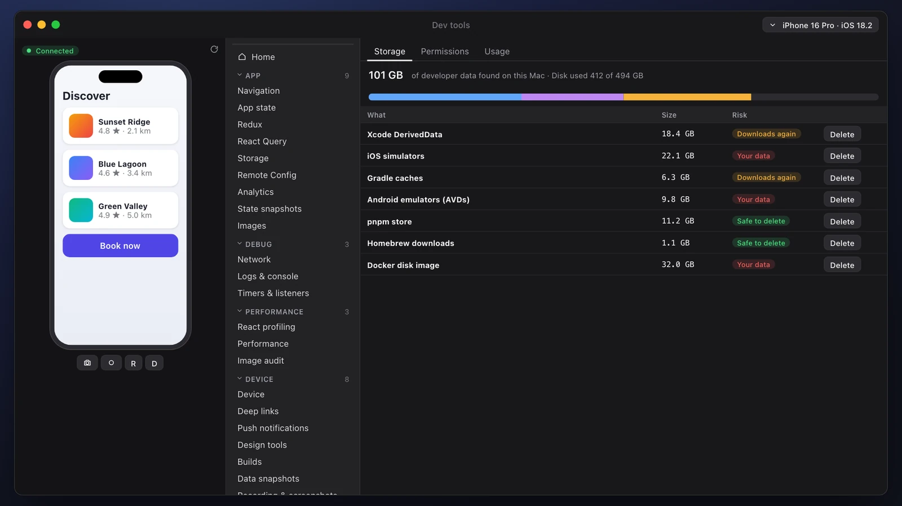
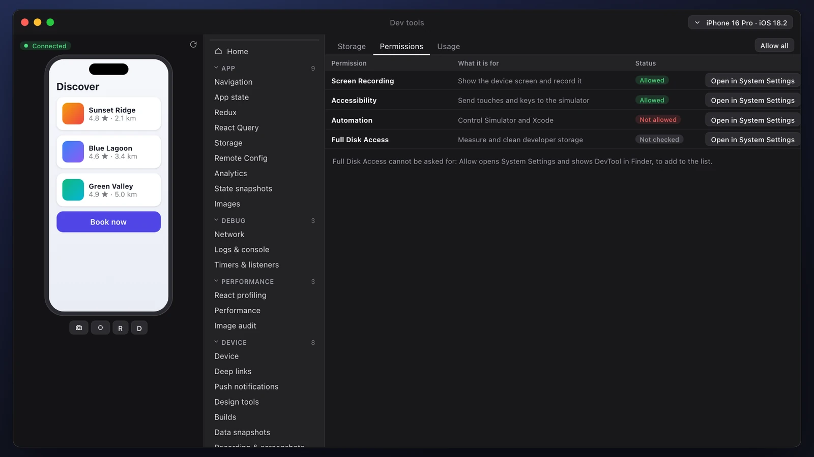
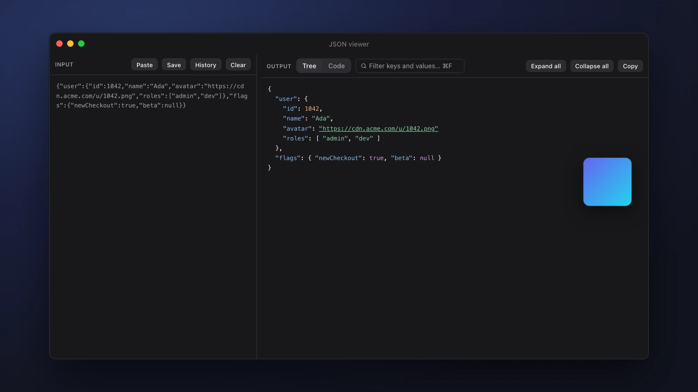
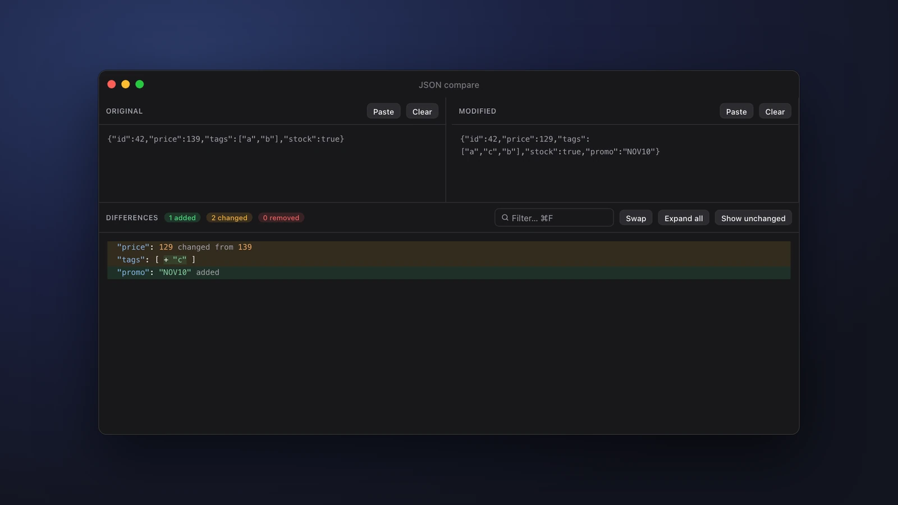
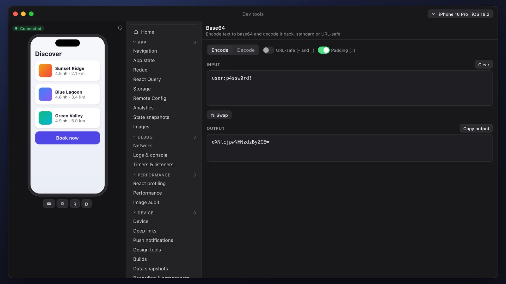
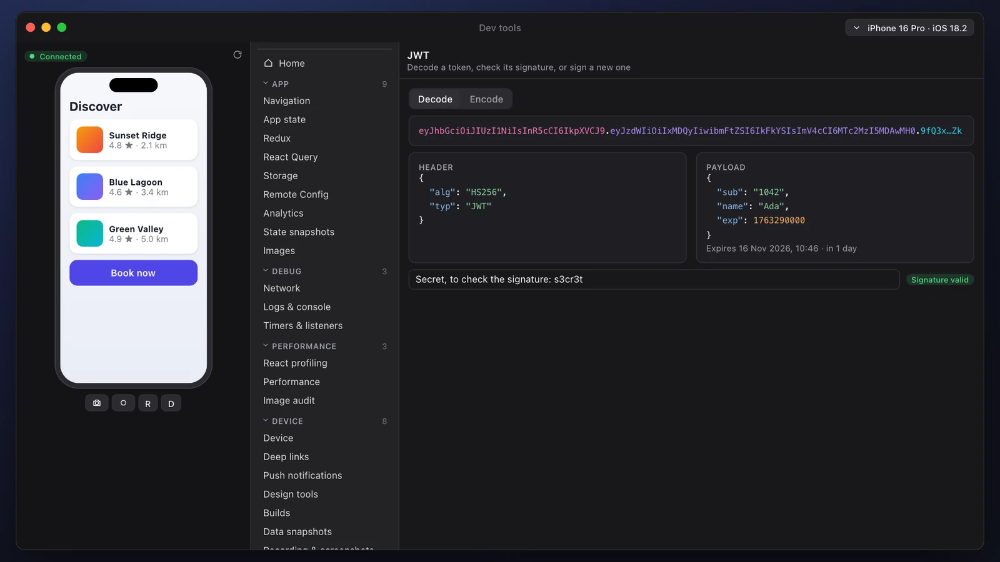

# Dev tools: computer and utilities

About your Mac, and small tools for everyday data.

[← All features](../../README.md#features)

**On this page:** [Mac storage](#mac-storage) · [Mac permissions](#mac-permissions) · [JSON viewer](#json-viewer) · [JSON compare](#json-compare) · [Base64](#base64) · [JWT](#jwt)

## Mac storage

Find what fills your disk and clear it safely.

- **Developer space hogs found for you:** Xcode DerivedData, archives, caches and device support; iOS simulators; Swift Package Manager and CocoaPods caches; Android SDK platforms, build-tools, NDK, emulator images and AVDs; Gradle; pnpm, npm and Yarn caches; Homebrew downloads; Rust crates; logs; iPhone backups; Trash; Docker
- **Labeled by risk:** safe to delete, downloads again, or your data
- **Sizes** measured for each, and **what is inside** each one
- **Delete** an item, or one thing inside it, after a confirmation that says what happens next
- **Disk used** shown at the top

## Mac permissions

The macOS permissions DevTool needs.

- **Status of each:** allowed, not allowed, or not checked, and what it is for
- **Allow all** in one click
- **Open System Settings** at the right page for each

## JSON viewer

Format, search and keep JSON.

- **Paste** JSON or a JavaScript object, with a paste-from-clipboard button
- **Tree or code view**, with expand all and collapse all
- **Search and filter** keys and values (⌘F), with matches highlighted
- **Image previews** when you hover an image link
- **Copy** any value, or the formatted document
- **Clear syntax errors** with the line and a window of the text
- **Save with a title** and reload from history
- Opens in its own window as well

## JSON compare

What changed between two documents.

- **Structural diff:** objects are matched by key and arrays by content, so one added key is one addition and an inserted item doesn't shift the rest
- **Added, removed and changed** are marked, with the previous value one click away
- **Swap** the two sides, **expand or collapse all**, **filter**, and **show unchanged**

## Base64

Encode and decode.

- **Standard or URL-safe**, with or without padding
- **Decodes** `data:` URIs too
- **Swap** the output into the input to go the other way

## JWT

Decode, verify and sign tokens.

- **Decode** a token to see its header, payload and expiry times
- **Verify** an HMAC signature with a secret
- **Sign a new token** with HS256, HS384 or HS512

