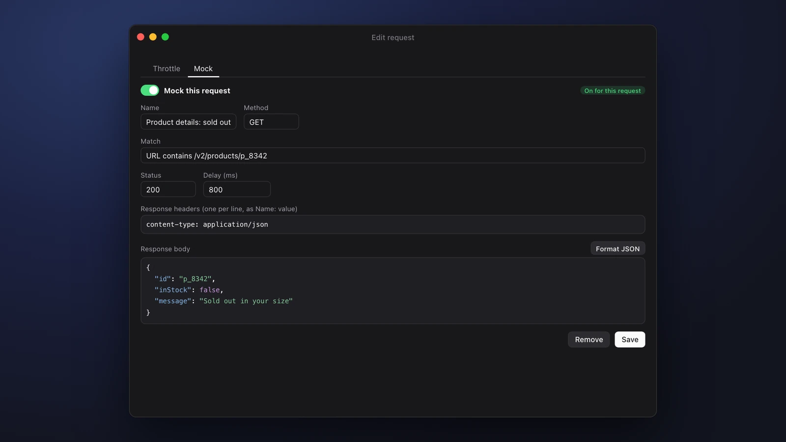
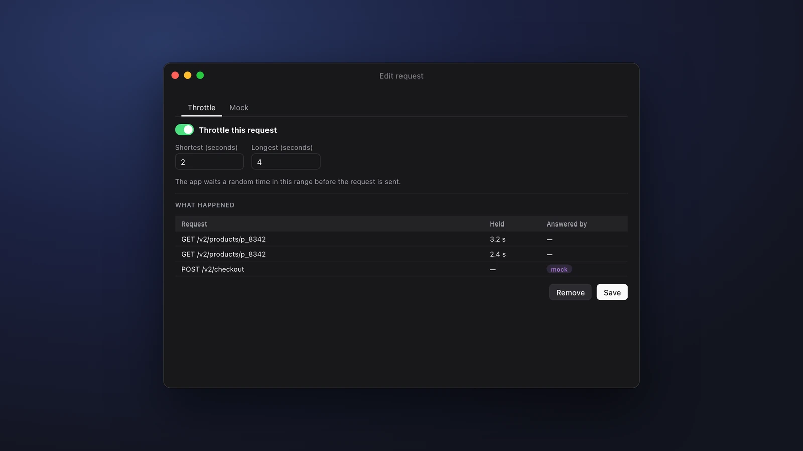
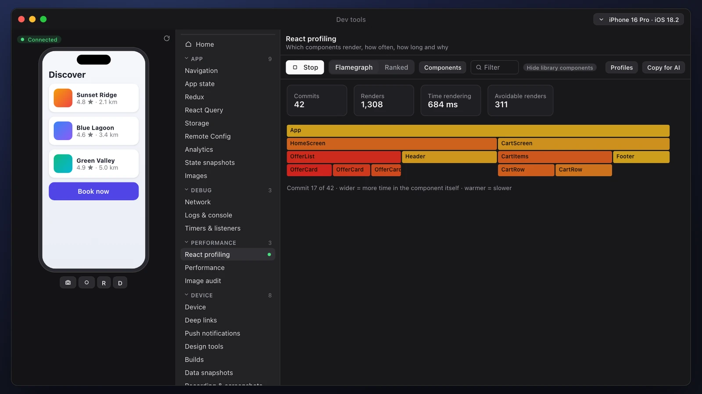
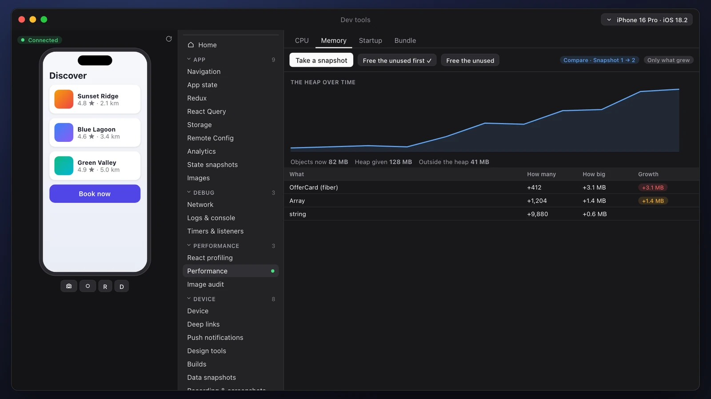

# Dev tools: debug and performance

Find out what the app is doing, and why it is slow.

[← All features](../../README.md#features)

**On this page:** [Network](#network) · [Logs and console](#logs-and-console) · [Timers and listeners](#timers-and-listeners) · [React profiling](#react-profiling) · [Performance](#performance) · [Image audit](#image-audit)

## Network

Every request the app makes, like Chrome's Network panel.

- **Request list** with name, status, size, time, and a Mock and Throttle column; filter and clear
- **Details:** headers (request and response), query string, payload, preview, response and timing
- **Call stack** for each request, with the line opened in your editor
- **Copy as cURL**
- **Mock responses:** answer a request with your own status, delay, headers and body; match by method and URL; turn rules on and off; start one from a real response
- **Mock rules dialog** to manage all your rules in one place
- **Throttle everything** with a random delay, and **throttle one request** with its own range
- **Request editor window** for a request's mock and throttle together
- **See what happened:** which requests were held, for how long, or answered by a mock
- **Reconnects on its own** and puts your mocks and throttles back

## Logs and console

Native logs and the JavaScript console in one tool.

- **Two sources:** the device's native logs, and the app's JS console
- **Level menu** (errors, warnings and so on) and a **columns menu**
- **Filter** text (⌘F), and filter by **app name**
- **Pause or stop** the stream; **clear**; follow the latest message
- **Copy** the visible lines, or **copy for AI** with a prompt that points to a saved file
- **Live indicator** shows whether lines are coming in

## Timers and listeners

Find leaks and runaway work.

- **Everything the app started and hasn't ended:** timers and event listeners
- **Where each was started** in your code, and which component started the most
- **What to look at:** places with many still running, or listeners added and never removed
- **How they ended:** running, ended, cleared or expired
- **Chain origin:** for something that restarts itself (a loop or a poll), the code that began it
- **Filters:** hide the ended ones, or show only places worth a look; **clear the ended**

## React profiling

Which components render, how often, how long, and why.

- **Record** and stop, then explore
- **Components view:** renders, wasted renders, self time, average and slowest, with the reasons shown as colored bars
- **Flame graph:** the component tree for a commit, wider for longer
- **Ranked chart** of time spent in each component
- **Commit chart:** every commit as a bar, with arrows to step through
- **Why did this render?** changed props and hooks, with before and after; flags **a new object with the same content**
- **Named hooks**, and **open the source** at the line where a hook is called
- **Avoidable renders**, and a hint when a prop changes on nearly every render
- **Hide library components**, and filter by name
- **Save and load profiles**, and **copy for AI** with a prompt that points to the recording

## Performance

Where the app's JavaScript spends time and memory.

- **CPU profile:** record for a while, then see the slowest functions, a call tree, and your code only
- **Memory:** the heap over time, snapshots, and compare two to see **only what grew**; free unused memory first
- **Startup:** how long each module took from launch to first screen, by package; **measure a new start**
- **Bundle:** the size of each package in your bundle, built as it would ship
- **Open in the editor** from any function or module

## Image audit

Find images that waste memory and data.

- **Audit this screen:** lists every image on screen with its original size, the size it is shown at, and what that costs
- **Flags:** oversized, blurry (upscaled), big in memory, big file, repeated downloads, not cacheable, wrong format, off screen, hidden
- **Savings:** memory and download size each fix would save, and a total
- **Sizes and cache headers** are read from the image's server when the network log missed them
- **Sort** by wasted memory, file size and more; **copy an image's address**

