# Dev tools: device

Change the device and the app's data without leaving the window.

[← All features](../../README.md#features)

**On this page:** [Device settings](#device-settings) · [Location](#location) · [App data](#app-data) · [Cookies and local storage](#cookies-and-local-storage) · [Deep links](#deep-links) · [Push notifications](#push-notifications) · [Design tools](#design-tools) · [Design overlay](#design-overlay) · [Builds](#builds) · [Data snapshots](#data-snapshots) · [Recording and screenshots](#recording-and-screenshots) · [Permissions](#permissions)

## Device settings

Set up the device the way a test needs.

- **Theme:** light or dark
- **Text size** and **display size**, including the accessibility sizes
- **Navigation mode:** gestures or 3 buttons (Android)
- **Date and time:** set by hand, or automatic; 24-hour clock
- **Reset** back to what the device had

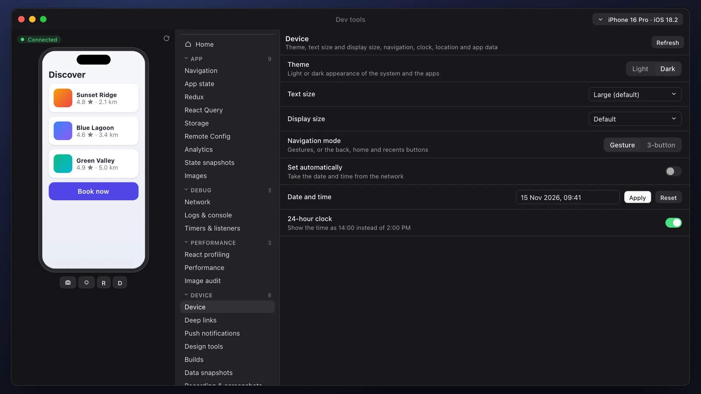

## Location

Put the device anywhere.

- **Mock the location** with latitude and longitude; paste "lat, long" from a map
- **Save places by name** and move the device with one click
- **Stop mocking** to return to the simulator's own location

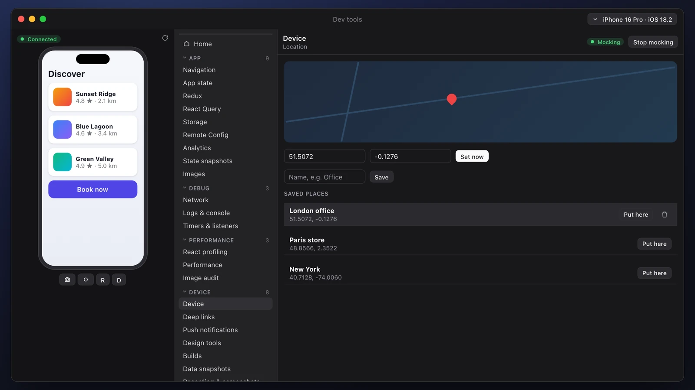

## App data

Start from a clean slate, quickly.

- **Clear the cache**
- **Clear all data:** starts the app as if just installed (data, settings, cache and permissions)
- **Reset the keychain** too, so signed-in sessions are gone
- **Open the app afterwards**

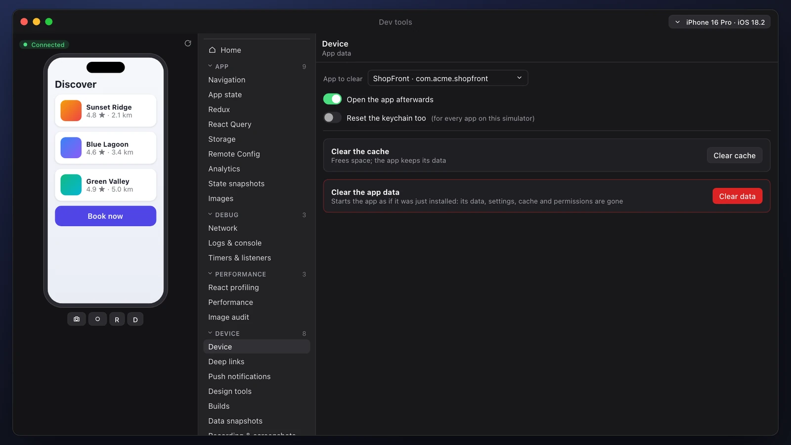

## Cookies and local storage

Look at and change what the app saved.

- **Cookies:** view, filter, copy, edit, add and delete; domain, path, expiry, Secure, HttpOnly and SameSite
- **AsyncStorage:** view, filter, copy, edit, add and delete; **format or minify** JSON values
- **Clear all** with a confirmation
- **Restart the app** after a change if you want it to read the new values

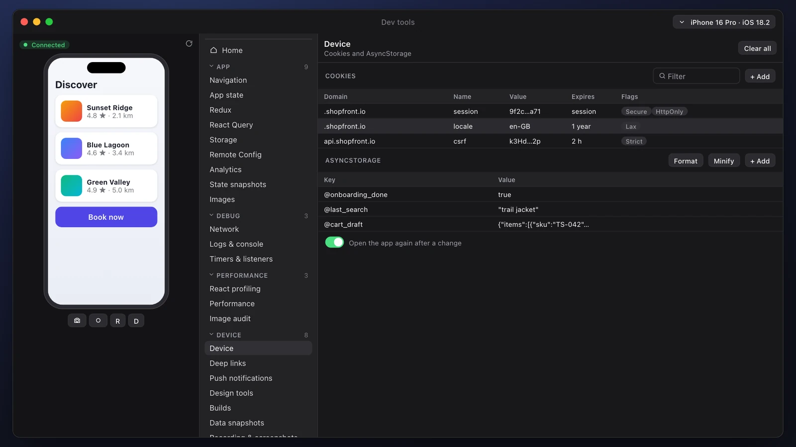

## Deep links

Open the app's links on the device.

- **Save links** with a name and an app, per platform
- **Open** one with a click, **edit** or **delete** it

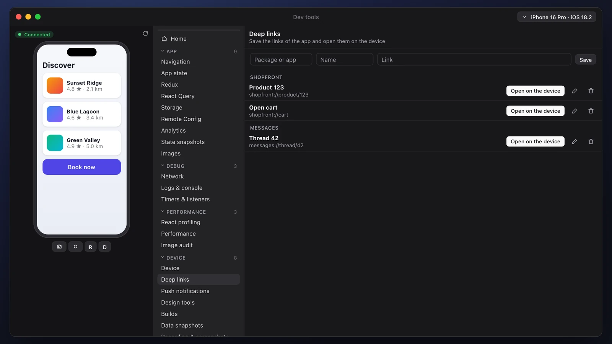

## Push notifications

Send a push as if it came from your server.

- **Templates:** alert, title, with a link, silent, data only, badge, with an image
- **Edit the payload** as JSON, with validation (including APNs limits)
- **Save payloads** by name per platform
- **iOS:** a real push through the simulator
- **Android:** a local notification showing the title, text and image

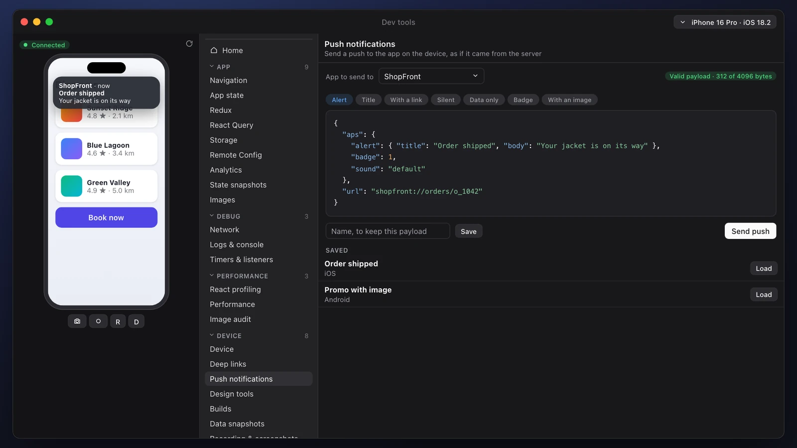

## Design tools

Check the screen against the design.

- **Alignment guides:** click a ruler to add one, drag it, and hold Shift to see spacing between guides; choose the color
- **Color picker:** pick any pixel on the device screen; recent colors with copy
- **Inspect:** click any element to see its component chain, dimensions, style and props; **open its source** in your editor; copy each section as JSON
- **Design overlay:** lay a screenshot of the design over the device screen

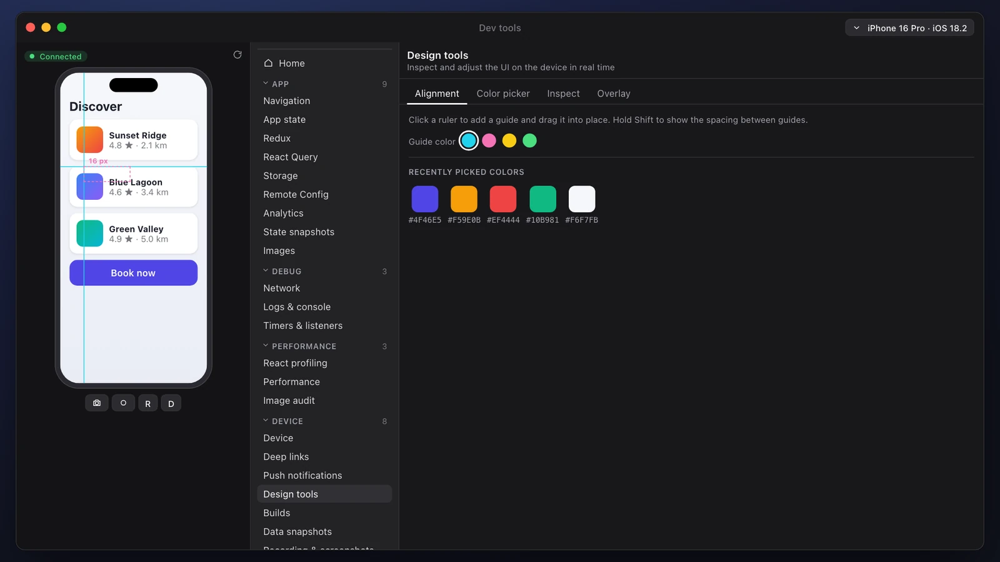

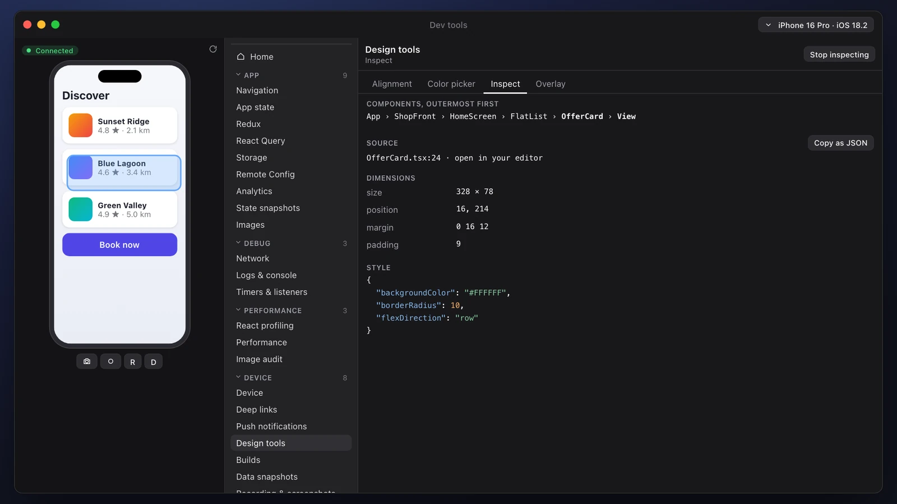

## Design overlay

Compare a design with the real screen.

- **Load a design** by choosing it, dropping it, or pasting it (⌘V)
- **Modes:** opacity, swipe with a draggable divider, and difference
- **Fit:** stretch, width or height, then scale and position by hand or with arrow keys
- **Save designs** with a label such as "Login" and reuse them
- **Also on the device:** draw it over the simulator or emulator window itself
- **Esc** stops the overlay

Opacity, swipe and difference on the same screen. <a href="images/design-overlay-demo.mp4">Watch it as a video</a>.

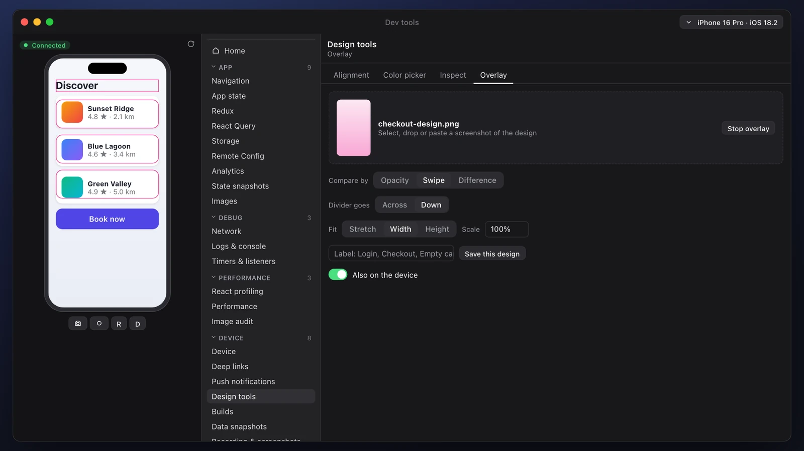

## Builds

Install an app on another device without rebuilding.

- **Save** the app from a device as a named build
- **Install** it on another device, optionally removing the app and its data first, and open it afterwards
- **Keep the app's data** with the build and restore it on install
- **Export to a file** and **import** one from another computer
- **Rename and delete** builds

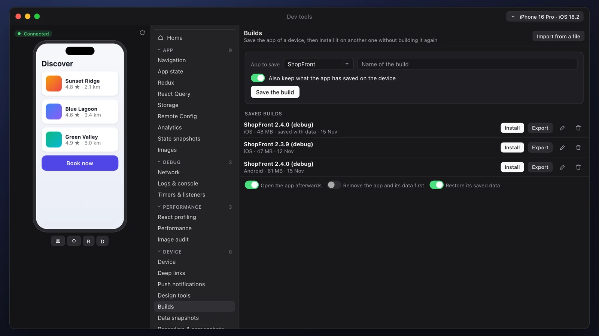

## Data snapshots

Save an app's data and put it back.

- **Save** cookies, storage and the rest an app keeps (the cache is never kept)
- **Restore** on the same device or another one, and open the app afterwards
- **Rename and delete** snapshots

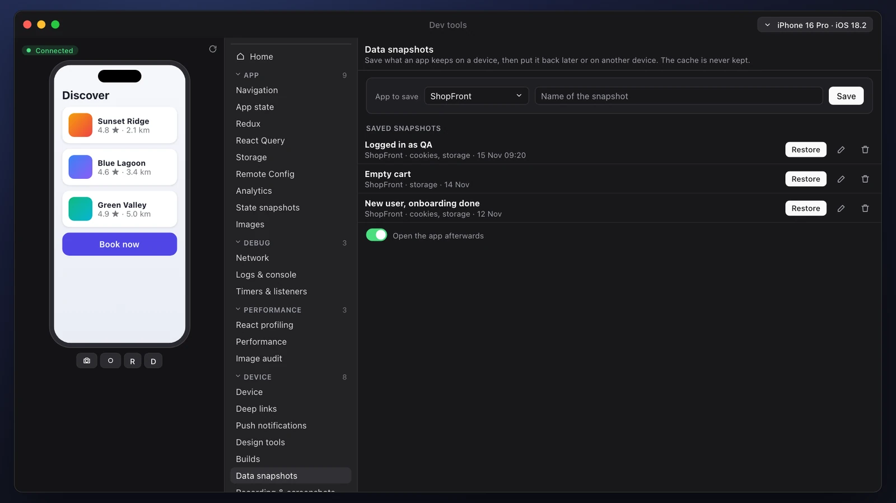

## Recording and screenshots

Everything you captured, in one place.

- **Record the screen** or **take a screenshot** from the tool
- **Find saved files:** play, review, copy, show in Finder, delete one or all
- **Mark up screenshots** and **review recordings** (see Quick bar)

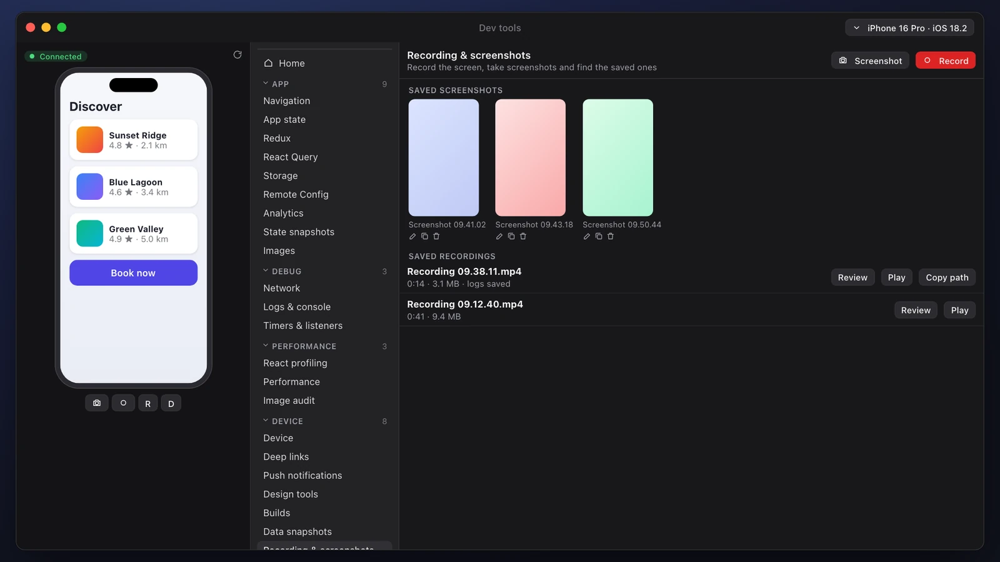

## Permissions

Grant and revoke permissions on a device.

- **Pick an app** and see the permissions it declares
- **Grant, revoke and reset** each one
- **Refresh** the status

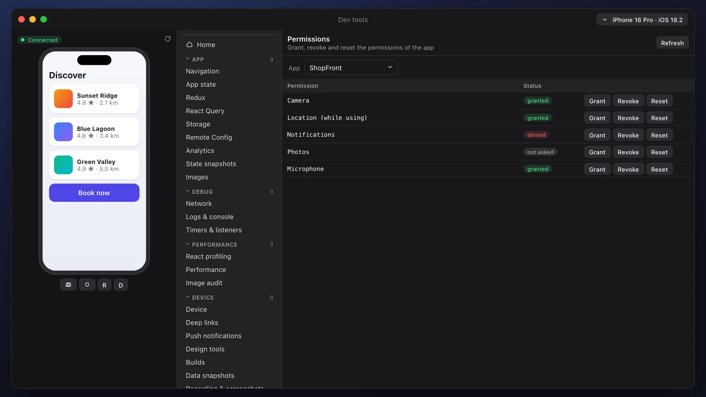
