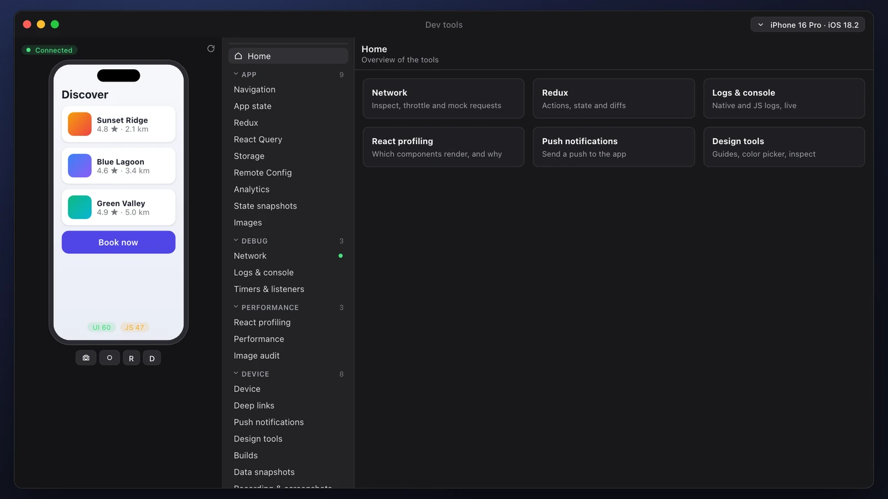
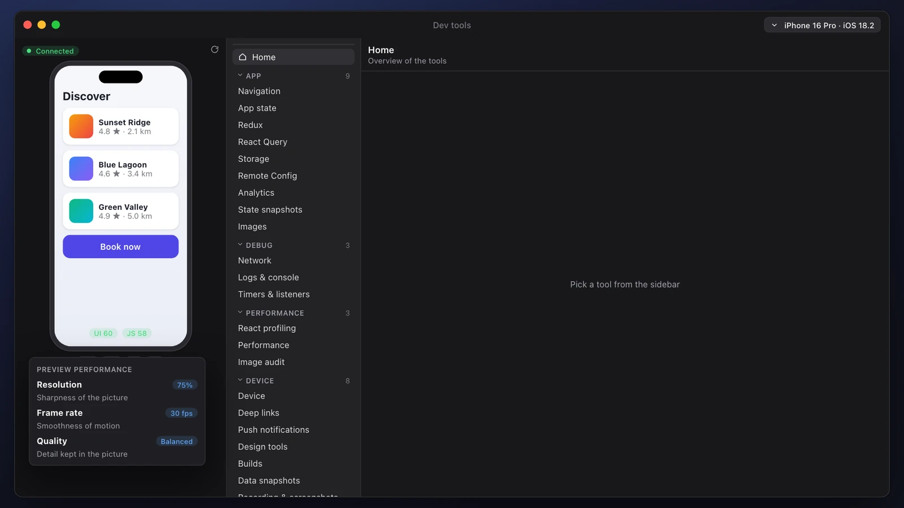
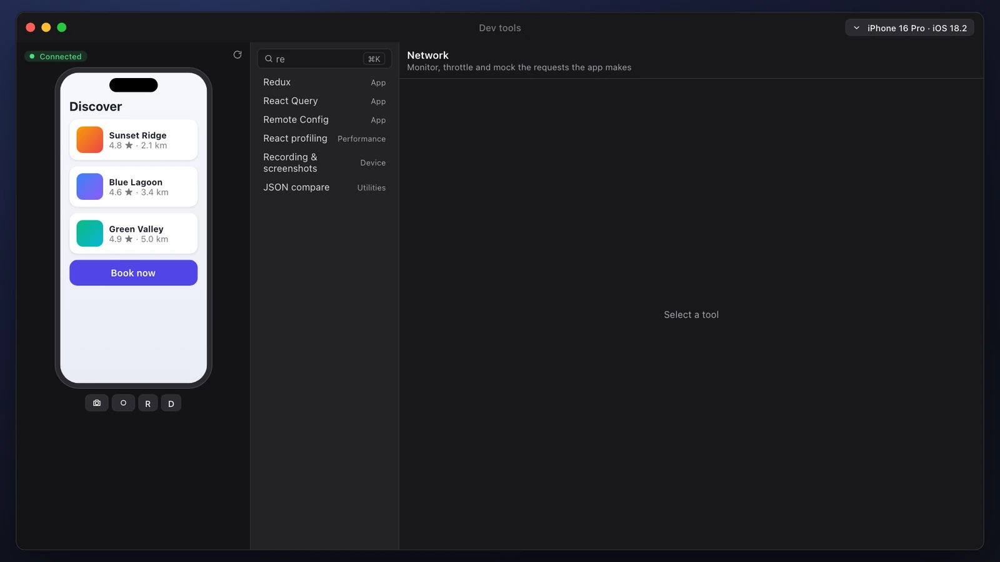
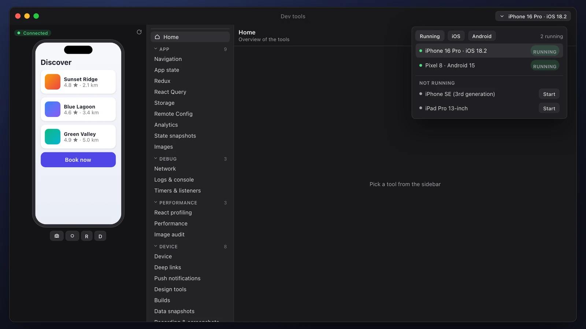
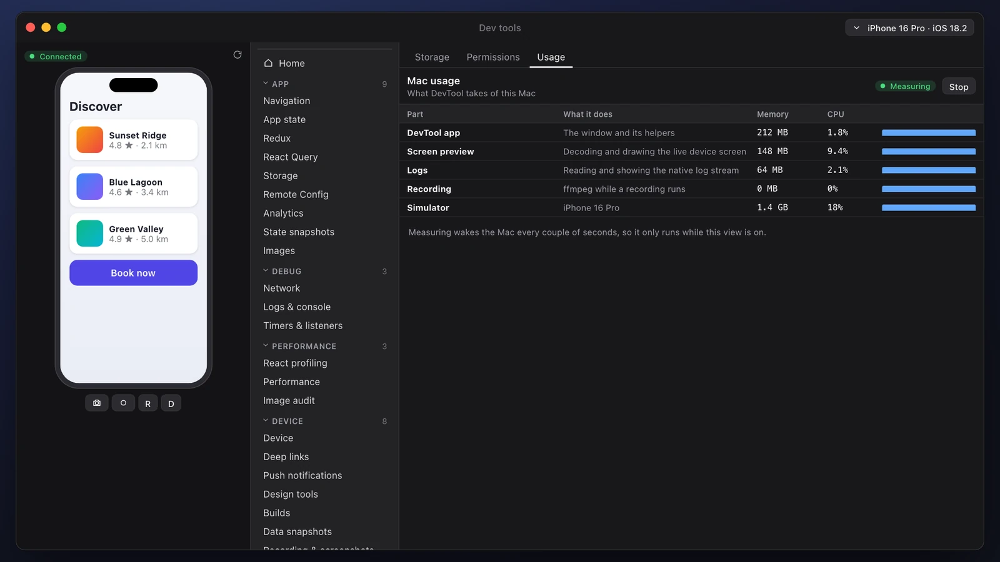

# Dev tools window

One window per device: its live screen on the left and a sidebar of tools on the right.

**To open it:** click the **dT** icon in the macOS menu bar, then choose **Open Dev tools**.

[← All features](../../README.md#features)

**On this page:** [Live device screen](#live-device-screen) · [Finding and running tools](#finding-and-running-tools) · [Choosing a Metro](#choosing-a-metro) · [Device switcher](#device-switcher) · [Mac usage](#mac-usage)

## Live device screen

Use the device from the window, and see how it performs.

- **Touch and keyboard:** click and drag act as a finger, the scroll wheel scrolls, and typing goes to the device
- **Buttons:** Back, Home, Recent apps and Lock
- **Reload with R, dev menu with D**, and a **relaunch** button
- **Resolution, frame rate and quality** menus, so you can trade sharpness for a lighter Mac
- **JS and UI thread FPS** strip over the screen, green, amber or red
- **Resize or hide** the screen
- **Screenshot and recording** buttons, and a status light that shows whether the app is connected
- **Drop or paste an image** on the window to compress it, mark it up, or make its sizes
- **Real iPhones:** the screen can't be streamed, but the tools still work on them

## Finding and running tools

Dozens of tools, easy to reach.

- **Search (⌘K)** by name, description or group
- **Grouped sidebar** that remembers what you collapsed
- **Greyed out** tools say why on hover, for example when the app isn't connected
- **Green dot** shows which tools are running, with a stop button
- **Only relevant tools:** the Redux, React Query, Navigation, Analytics and Remote Config tools appear only for projects that use them

## Choosing a Metro

With several projects or branches running, each has its own Metro. The picker at the right of the header lists them all, as `:port · folder · device`.

- **You choose, DevTool never switches for you.** The choice is remembered. With two or more Metros and no choice yet, the picker asks you to select one
- **The app follows your pick.** Choosing a Metro points the app on this device at it and reloads: on an iOS simulator through the app's bundler setting (what *Configure Bundler* in the dev menu does), on Android through `adb reverse`. A **Point app at :port** button appears when the app is on a different Metro than the one chosen
- **Tools stay with the app.** Debugging sessions connect to the Metro the app is actually on, and your pick decides which one the header and the tool list describe
- Not supported: real iPhones (change the bundler address in the dev menu), and Android apps that reach Metro by an address other than `localhost`
- Ports 8081 to 8099 and 19000 to 19006 are scanned

## Device switcher

Change device without closing the window.

- **Running tab** to switch between devices that are on
- **Start or stop** any simulator, emulator or device from the menu
- **Notes** on each device
- **Android Wi-Fi pairing** and connection

## Mac usage

See what DevTool costs your Mac.

- **Memory and CPU** of the app, its windows, the screen preview, logs and recording, and the emulator or simulator
- **Measures only while open**, so it never wakes your Mac in the background
- Explains what each part is for and what it costs to keep it on

