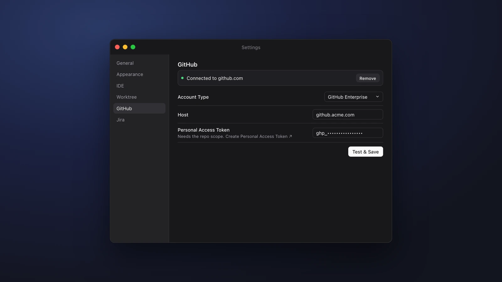
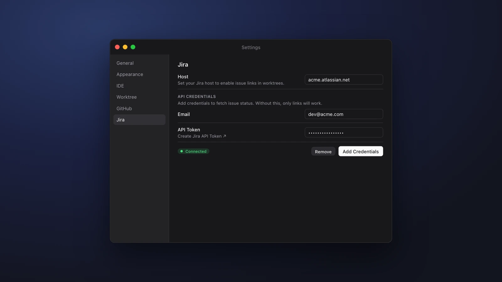
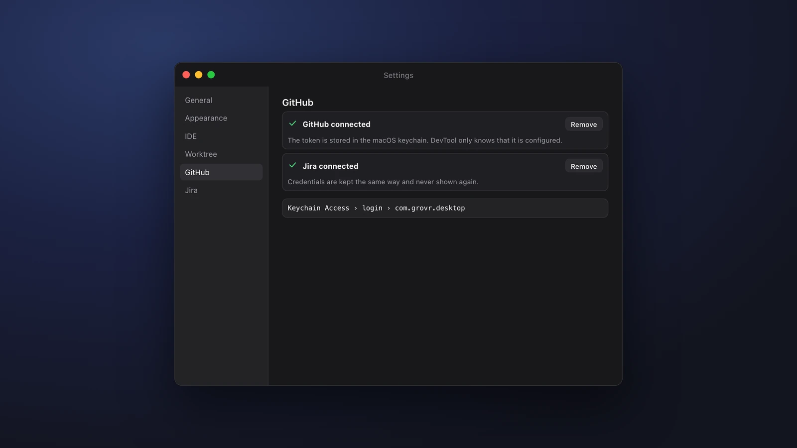

# GitHub and Jira

See pull request and issue state next to your worktrees.

[← All features](../../README.md#features)

## GitHub

Pull request information without opening a browser.

- **Personal access token** with a link that opens the page to create one
- **GitHub Enterprise:** choose the account type and enter your host
- **Shows:** pull request state, draft or ready, review state and CI status
- **Test on save:** the token is checked before it is stored

## Jira

Issue state and links on every worktree.

- **Host only:** enough to get a link to each issue from the branch name
- **Add credentials** (email and API token) to also see each issue's status
- **Create worktrees from issue keys**, and open issues from the list

## Your credentials stay on your Mac

Tokens are kept safe.

- **macOS keychain:** tokens are stored there, never in a settings file
- **Never sent to the interface:** the app only learns whether something is configured
- **Remove** a connection with one click

