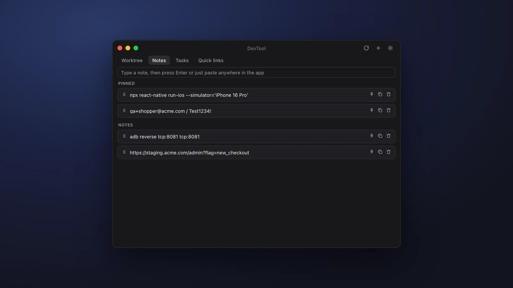
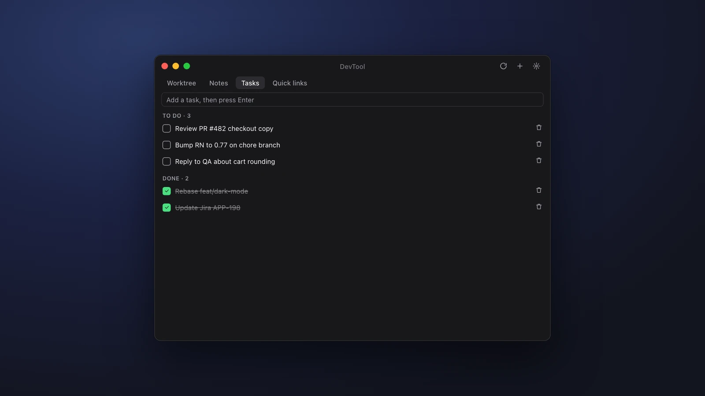
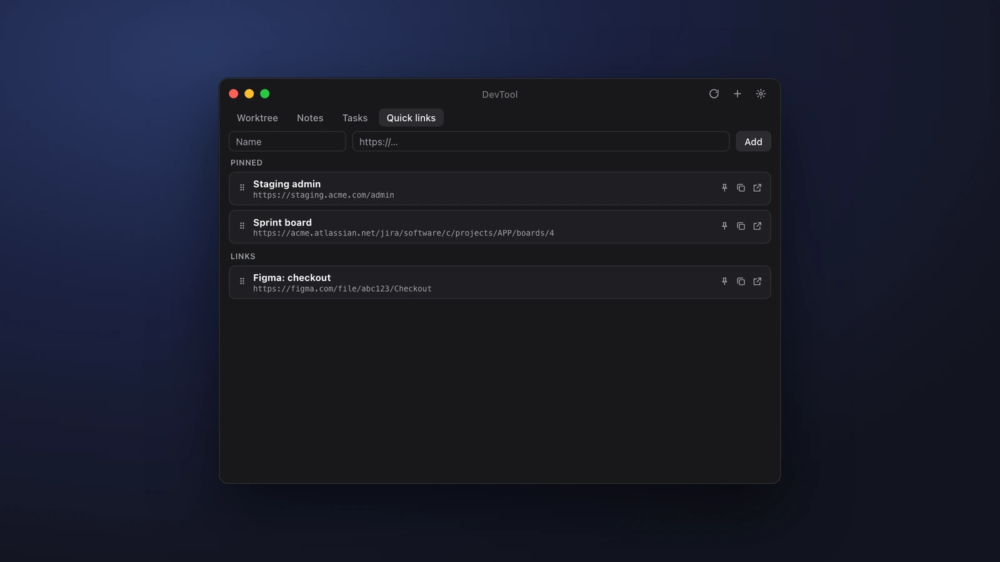

# Notes, tasks and quick links

Small things you reach for all day, one click away.

[← All features](../../README.md#features)

## Notes

Snippets you copy again and again.

- **Add:** type and press Enter, or **paste anywhere in the app** and the clipboard becomes a note
- **Click to copy** a note
- **Edit, delete and pin** notes; pinned ones stay at the top
- **Drag to reorder**

## Tasks

A tiny to-do list.

- **Two groups:** To do and Done
- **Tick** a task to move it between groups
- **Click to edit**, delete from the row
- **Spotlight:** type `dev:task` and press Enter to open the tab with the input ready

## Quick links

Named links to the pages you open every day.

- **Add** a name and a link, **pin**, copy, edit and delete, and **drag to reorder**
- **Open** in your browser with one click
- **Spotlight:** type `dev:<name>` and press Enter to open one
- **Safe:** `file:`, `javascript:`, `data:`, `vbscript:` and `blob:` links are blocked

