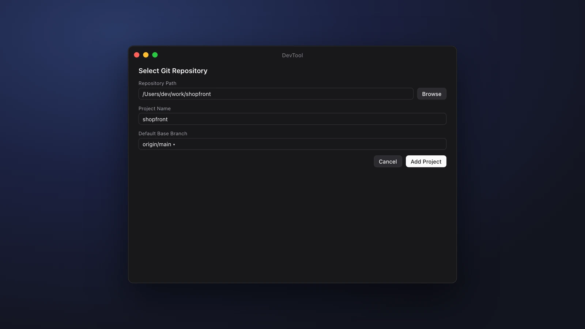
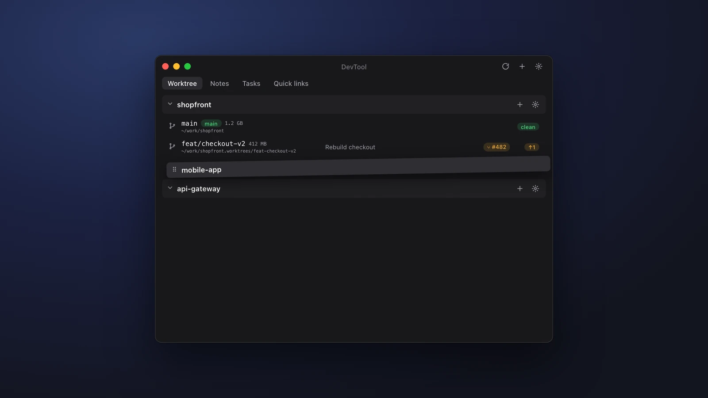
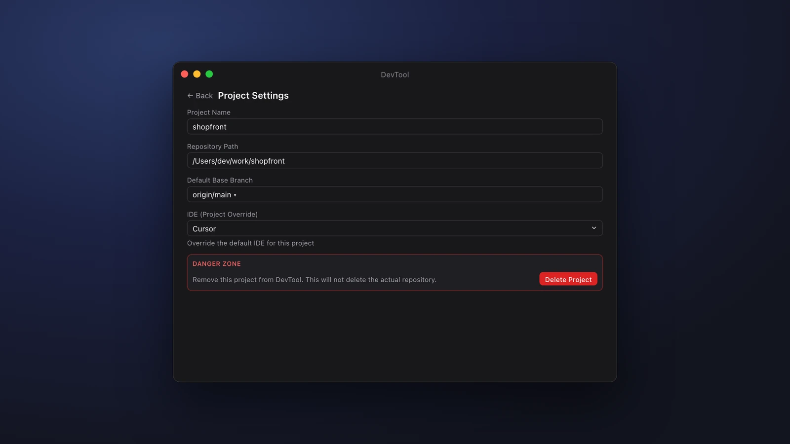

# Projects

Keep several repositories in one place.

[← All features](../../README.md#features)

## Add a project

Point DevTool at a repository.

- **Browse** to a Git repository, or type its path
- **Name** it, and set its **default base branch**
- A new project expands on its own so you see its worktrees at once

## Switch and reorder

Move between projects quickly.

- **Expand or collapse** each project in the list
- **Drag** projects into your preferred order
- DevTool **remembers** the last project you used

## Project settings

Per-project choices.

- **Name, path and default base branch**
- **Editor override:** open this project in a different editor from your default
- **Danger zone:** remove the project from DevTool. Your repository is never deleted

