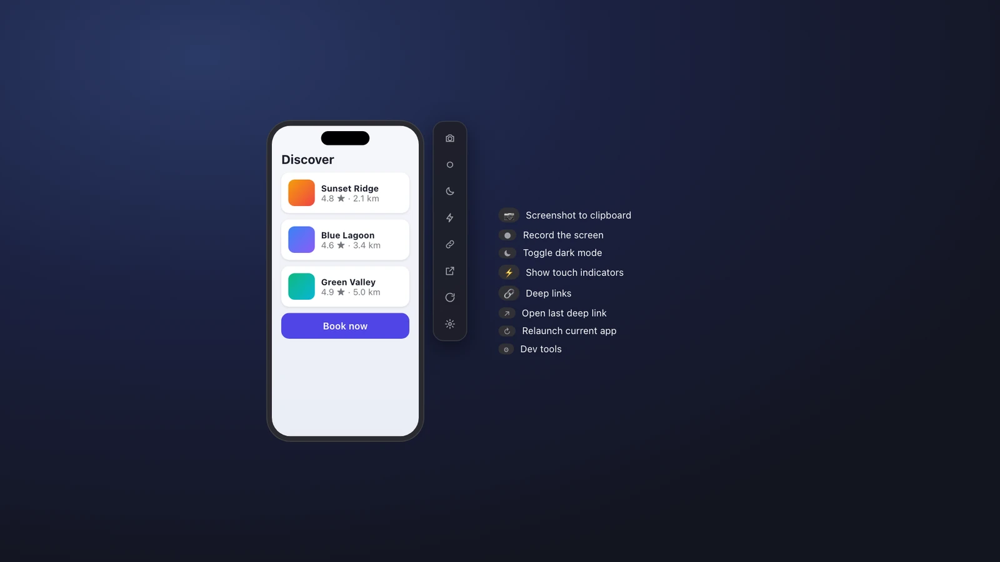
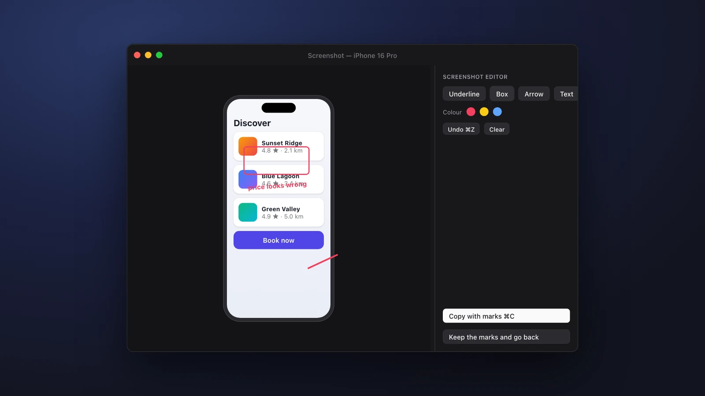
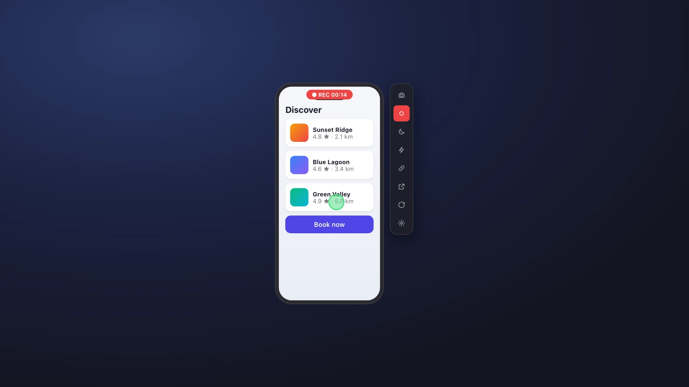
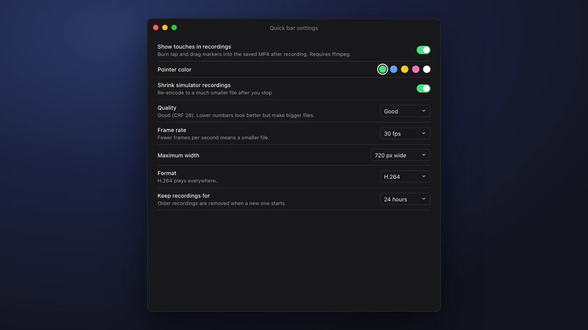
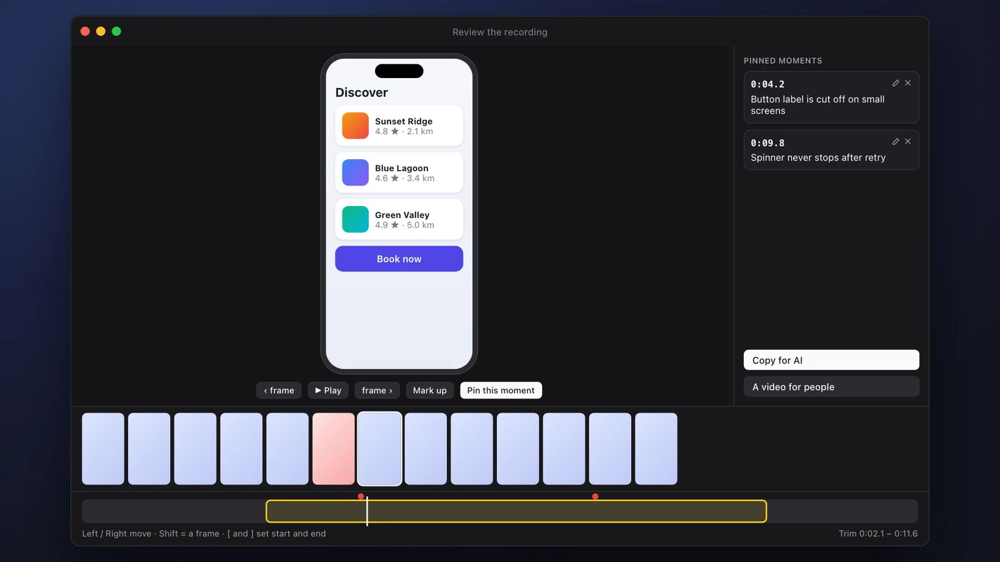
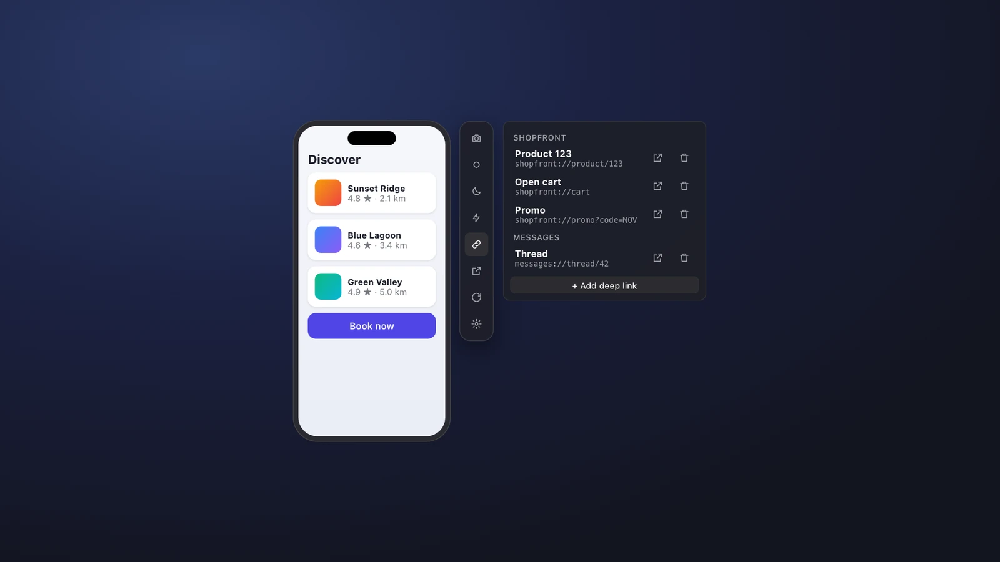
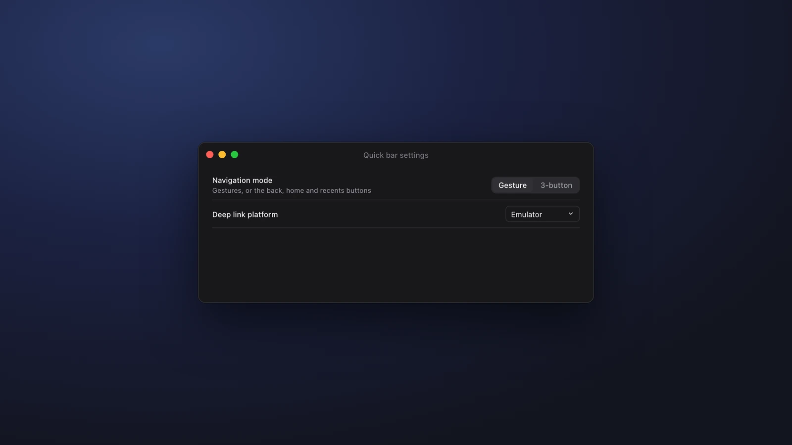

# Quick bar

A small bar docked beside a running device.

[← All features](../../README.md#features)

**On this page:** [The bar](#the-bar) · [Screenshot](#screenshot) · [Screen recording](#screen-recording) · [Review a recording](#review-a-recording) · [Deep links on the bar](#deep-links-on-the-bar) · [Android navigation mode](#android-navigation-mode)

## The bar

It follows the device window and sits right above it.

- **Screenshot** to the clipboard
- **Record** the screen
- **Dark mode** toggle
- **Touch indicators:** show touches on iOS, and taps with a pointer trace on Android
- **Deep links** list for the device
- **Open last deep link** again
- **Relaunch** the current app
- **Dev tools:** opens the Dev tools window for this device
- Toasts over the device report results and errors

## Screenshot

One click, ready to paste.

- **Copied to the clipboard** as an image
- **Also save to the Desktop** if you turn it on
- **Mark up** afterwards with underline, box, arrow and text, then copy again
- **Saved screenshots** are listed in settings: open, copy, mark up, show in Finder, delete

## Screen recording

Capture what happened and share it.

- **Record and stop** from the bar; a REC timer shows over the device
- **Touch markers** burned into the video, in a color you choose
- **Shrink the video** with ffmpeg: choose quality, frame rate, maximum width (1080, 720, 540) and format (H.264 or HEVC)
- **Capture logs** next to each recording, included in the prompt you copy
- **JavaScript logs only** option for React Native
- **File path copied** to the clipboard when it stops
- **Auto-delete** old recordings after 1 hour to 7 days, or never
- **Saved recordings:** play, review, copy the path, show in Finder, delete

## Review a recording

Turn a recording into a precise bug report.

- **Frame strip** to move through the video, with **frame stepping** (Shift + arrows)
- **Trim** the part that matters like in a video player, and play it while trimming
- **Pin moments** with a short note such as "what is wrong here?"
- **Mark up** a pinned frame: underline, box, arrow, text
- **Copy for AI:** saves the pinned frames, the trimmed clip and the logs from around it, and copies a prompt that points to them
- **Copy a frame** as an image to paste into a chat
- **A video for people:** the kept part with each pinned frame held still, marks and notes included
- **Save trim only**, without pins

## Deep links on the bar

Open links in the app under test.

- **Grouped by app**, per platform
- **Add** a link with a name and the app it belongs to; **open** or **delete** it
- **Open last link** with one click

## Android navigation mode

Switch between gestures and buttons.

- **Gesture or 3-button** navigation from the quick bar settings

