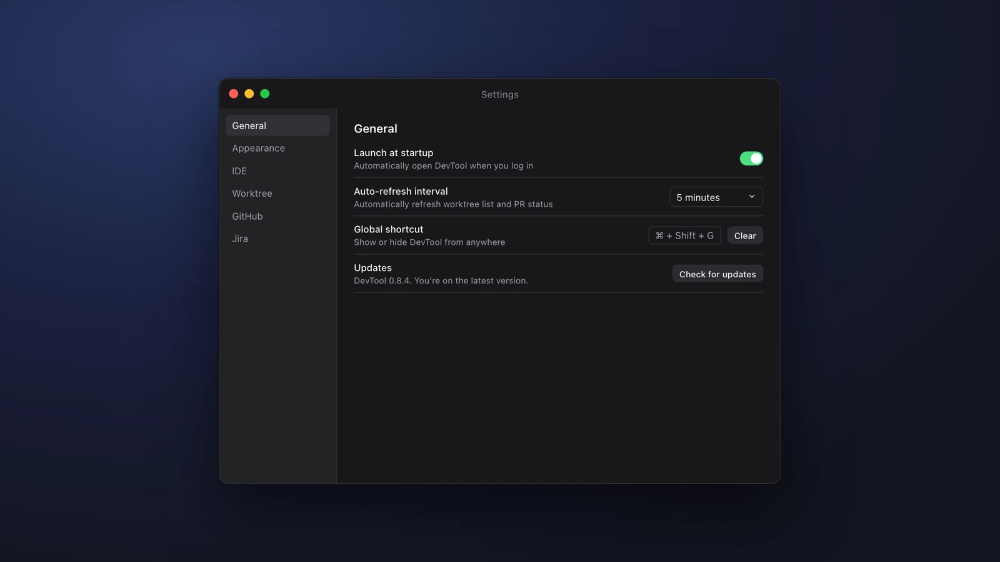
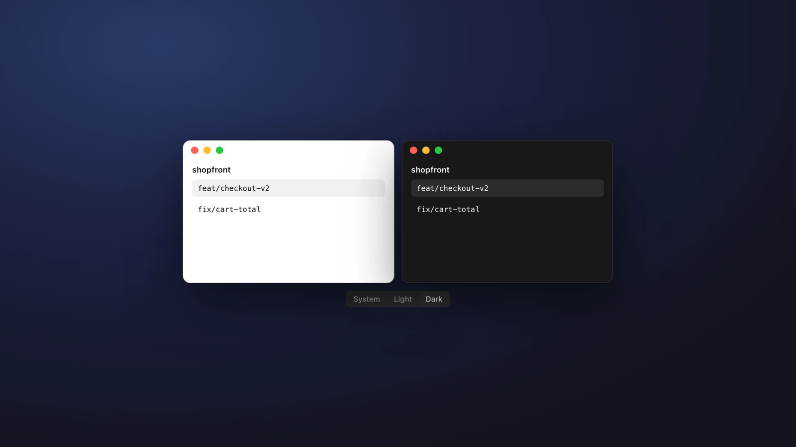
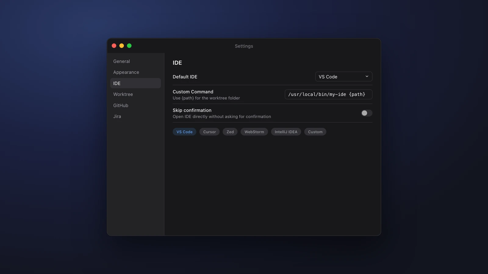
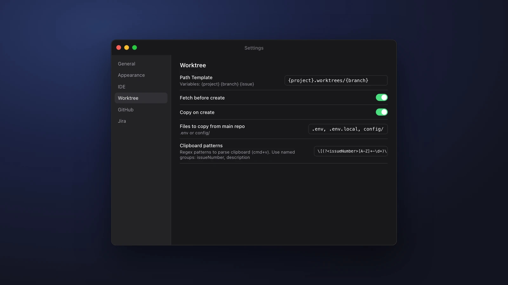

# Settings

Make DevTool fit the way you work.

[← All features](../../README.md#features)

**On this page:** [General](#general) · [Appearance](#appearance) · [IDE](#ide) · [Worktree](#worktree)

## General

Behaviour of the app itself.

- **Auto-refresh interval** for the worktree list and PR status, or off
- **Global shortcut:** record a key combination to show or hide DevTool from anywhere
- **Launch at startup** with the native macOS login item
- **Check for updates** by hand, with the exact reason shown if the check fails

## Appearance

Light, dark or follow the system.

- **System, Light or Dark** mode
- A translucent macOS window that follows the theme

## IDE

Your default editor.

- **Default editor** from a list of popular IDEs
- **Custom command** with `{path}` as the folder
- **Skip confirmation** to open straight away

## Worktree

How new worktrees are made.

- **Path template** with variables for where new worktrees go
- **Clipboard patterns:** your own regexes, with named groups, for creating from the clipboard
- **Fetch before create** and **Copy on create**
- **Files to copy** from the main repo, such as `.env` or `config/`

