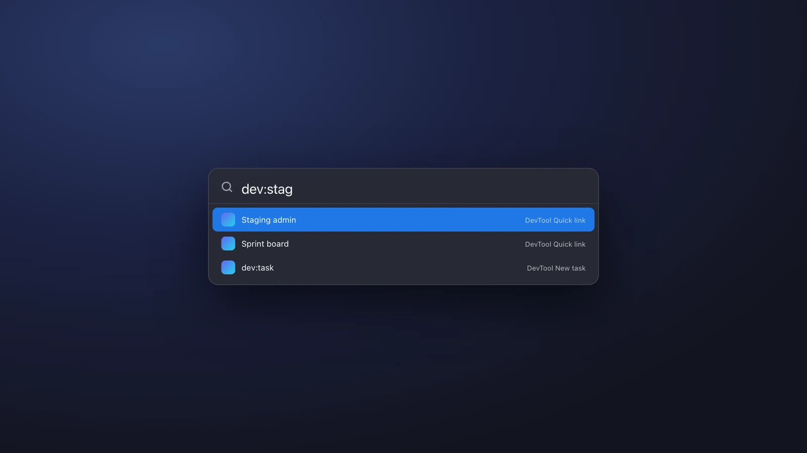
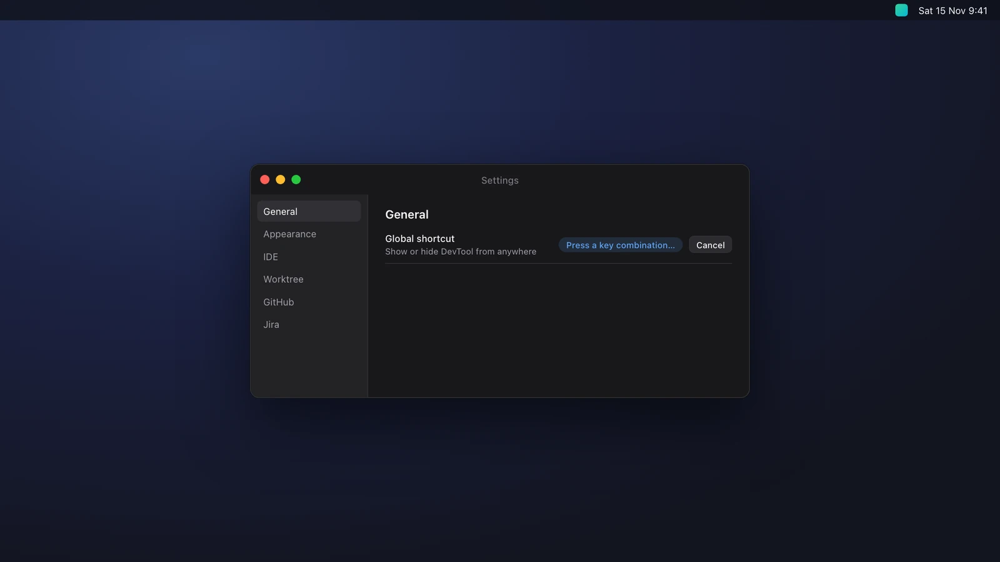
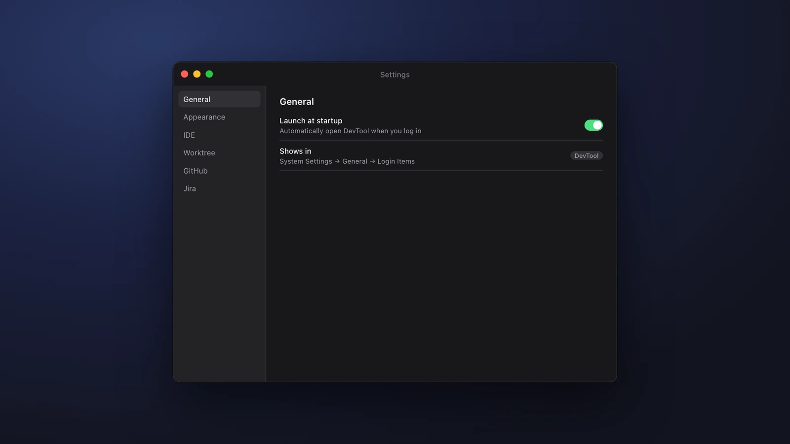
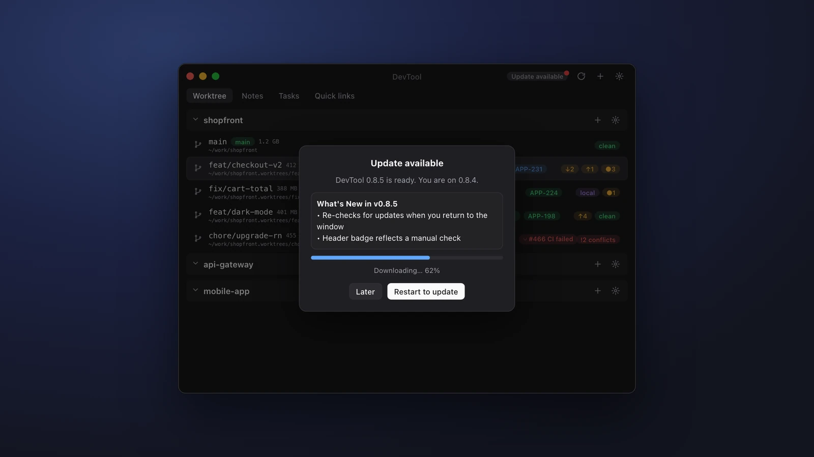

# Working with macOS

DevTool behaves like a Mac app.

[← All features](../../README.md#features)

**On this page:** [Spotlight](#spotlight) · [Global shortcut and menu bar](#global-shortcut-and-menu-bar) · [Launch at login](#launch-at-login) · [In-app updates](#in-app-updates)

## Spotlight

Reach DevTool from anywhere.

- **`dev:<link name>`** opens a quick link
- **`dev:task`** opens the Tasks tab with a new task ready
- Entries are kept up to date as you edit, and macOS removes them if you uninstall the app

## Global shortcut and menu bar

Show it when you need it.

- **Shortcut:** record your own to show or hide the window from any app
- **Menu bar icon** for quick access

## Launch at login

Always ready.

- Uses the **native macOS login item**, so it appears in System Settings like any other app

## In-app updates

New versions arrive without a download.

- **Update badge** in the header when a release is out
- **Release notes** shown in the dialog, then **download and restart** from there
- **Checks** at startup and again when you return to the window
- **Check for updates** by hand in Settings, General
- **Signed:** only updates signed by the developer are accepted

