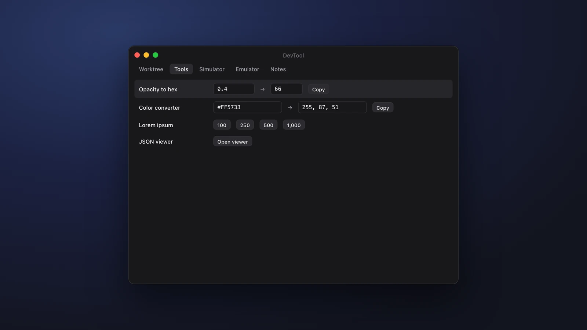
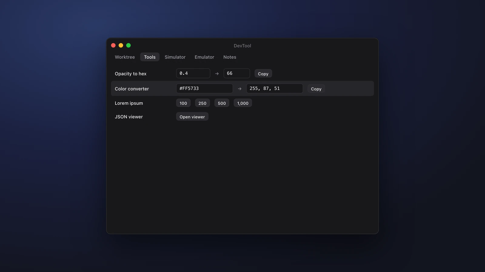
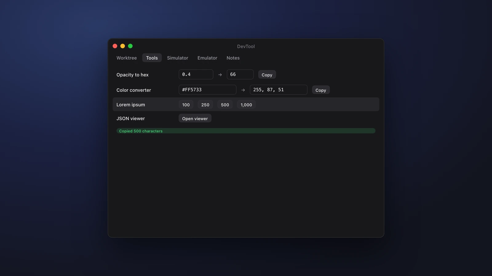

# Small utilities

Quick converters for design and copywriting.

[← All features](../../README.md#features)

## Opacity to hex

Turn 0 to 1 into the alpha value.

- Enter an opacity and **copy the two-digit hex** to add to a color

## Color converter

Hex and RGB both ways.

- Accepts `#FF5733` or `255, 87, 51`
- **Copy** the result

## Lorem ipsum

Placeholder text of the right length.

- **100, 250, 500 or 1,000** characters, copied in one click

