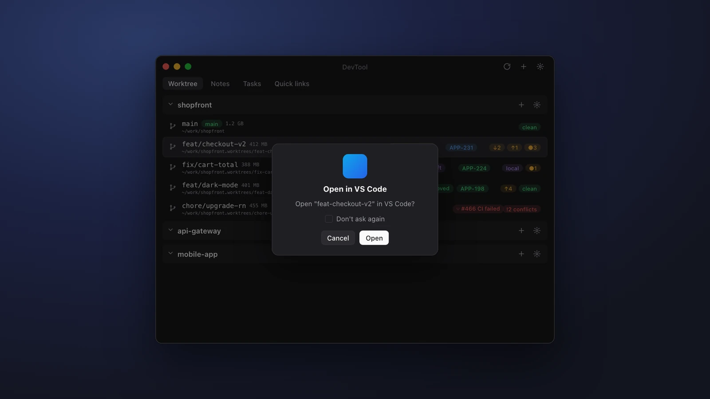
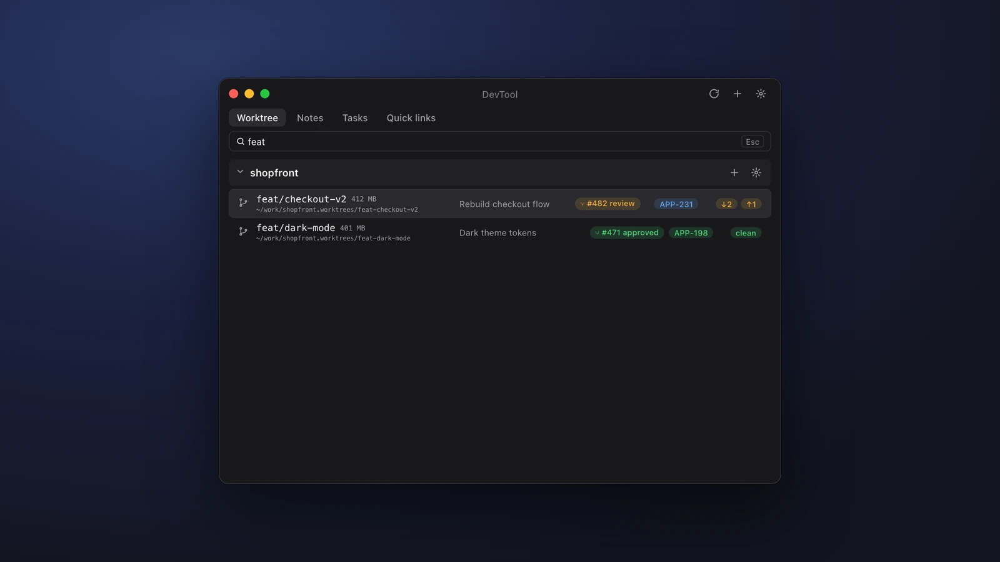
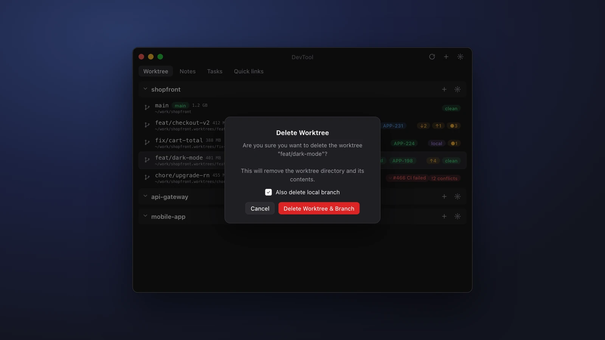

# Worktrees

Create, open and clean up Git worktrees without leaving the app.

[← All features](../../README.md#features)

**On this page:** [Worktree list](#worktree-list) · [One-click IDE launch](#one-click-ide-launch) · [Search and keyboard navigation](#search-and-keyboard-navigation) · [Quick actions on each row](#quick-actions-on-each-row) · [Create a worktree](#create-a-worktree) · [Create from the clipboard](#create-from-the-clipboard) · [Deep links](#deep-links) · [Edit and delete](#edit-and-delete)

## Worktree list

Every worktree of the selected project, with its state visible at a glance.

- **Branch and folder:** each row shows the branch name with the folder path under it
- **Git status chips:** commits to pull, commits to push, staged files, changed files, conflicts, **local** when there is no upstream yet, and **clean**
- **Pull request status:** draft, review requested, approved, and the CI result
- **Jira status:** the state of the issue the branch belongs to
- **Size on disk:** how much space each worktree takes
- **Reorder:** drag rows into the order you want
- **Refresh:** one button reloads everything; status is read on refresh, with no background polling

## One-click IDE launch

Click a worktree and it opens in your editor.

- **Editors:** VS Code, Cursor, Zed, JetBrains IDEs, or any custom command
- **Custom command:** write your own, using `{path}` for the worktree folder
- **Per-project editor:** a project can use a different editor from your default
- **Confirmation:** a dialog with the editor's icon, with **Don't ask again** to skip it from then on

## Search and keyboard navigation

Work through the list without touching the mouse.

- **Type to search** the worktrees
- **Arrow keys** move the highlight
- **Enter** opens the highlighted worktree
- **Esc** clears the search
- Forms and dialogs have keyboard shortcuts too

## Quick actions on each row

Hover a row to reach the things you do next.

- **Terminal:** open a terminal in the worktree
- **Finder:** reveal the folder
- **Xcode and Android Studio:** shown when the project has native iOS or Android folders
- **Run:** start the project's `start` script from `package.json` in a Terminal tab
- **More actions:** edit or delete the worktree

## Create a worktree

Start new work in its own folder in a few fields.

- **Base branch:** pick any local or remote branch to start from
- **Fetch before create:** pull the latest first, so you branch from fresh code
- **Branch name** built from an **issue number** and a short **description**
- **Folder:** generated for you from your path template, so worktrees stay tidy
- **Copy files:** bring files such as `.env` or config folders from the main repo into the new worktree
- **Auto-expand:** the new worktree appears straight away under its project

## Create from the clipboard

Paste something you already have and let DevTool read the branch name from it.

- **Jira issue keys** such as `ABC-1234`
- **GitHub pull request URLs**
- **Your own patterns:** add regexes with named groups (`issueNumber`, `description`) for any other format
- Fills in the issue number and description, so the branch name follows your convention

## Deep links

Create a worktree from outside the app.

- **`devtool://` links** open the create form from other tools, scripts or a browser
- **Branch parameter** to pre-fill the branch
- Useful for a button in a ticket, a chat bot or a shell alias

## Edit and delete

Tidy up when the work is done.

- **Rename the branch** and edit the description and issue number (the main branch can't be renamed)
- **Delete a worktree** with a confirmation that shows progress
- **Also delete the local branch** with one checkbox, so no orphaned branches pile up
- **Force delete:** if the worktree has local changes you are told why and asked before it is removed

